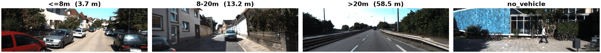

KITTI Distance
==============

.. raw:: html

   

   
   
   
   

Overview
--------
KITTI Distance asks how far away the closest vehicle (car, van or truck) is in a single front-camera frame from the
KITTI driving benchmark. Labels come from KITTI's 3D object annotations: the smallest camera-frame depth ``z`` over all
vehicles is binned into four classes, ``<=8m``, ``8-20m``, ``>20m`` and ``no_vehicle``. This is the
``kitti/closest_vehicle_distance`` task of VTAB-1k and the "KITTI Distance" dataset in CLIP's evaluation suite. Unlike most
classification benchmarks it probes spatial/depth understanding rather than object identity.

The 7,481 labelled frames of KITTI's object ``training`` set are split **by drive** (no drive appears in two splits),
reproducing the TFDS ``kitti`` v3 split used by VTAB:

- **Train**: 6,347 images
- **Validation**: 423 images
- **Test**: 711 images

Data Structure
--------------

When accessing an example using ``ds[i]``, you will receive a dictionary with the following keys:

.. list-table::
   :header-rows: 1
   :widths: 20 20 60

   * - Key
     - Type
     - Description
   * - ``image``
     - ``PIL.Image.Image``
     - ~375×1242×3 RGB image (left colour camera)
   * - ``label``
     - int
     - 0: ``<=8m``, 1: ``8-20m``, 2: ``>20m``, 3: ``no_vehicle``
   * - ``distance``
     - float
     - Depth of the closest vehicle in metres (1000.0 if there is none)

Usage Example
-------------

.. code-block:: python

    from stable_datasets.images import KITTIDistance

    # First run downloads ~12 GB of KITTI images (+ labels and devkit) and prepares the cache.
    ds = KITTIDistance(split="train")
    ds_all = KITTIDistance(split=None)  # train / validation / test

    sample = ds[0]
    print(sample.keys())  # {"image", "label", "distance"}

    ds_torch = ds.with_format("torch")

References
----------

- Official website: https://www.cvlibs.net/datasets/kitti/eval_object.php?obj_benchmark=3d
- Task definition: https://github.com/google-research/task_adaptation (``kitti/closest_vehicle_distance``)
- License: CC BY-NC-SA 3.0

Citation
--------

.. code-block:: bibtex

    @inproceedings{geiger2012kitti,
        title={Are we ready for Autonomous Driving? The KITTI Vision Benchmark Suite},
        author={Geiger, Andreas and Lenz, Philip and Urtasun, Raquel},
        booktitle={Conference on Computer Vision and Pattern Recognition (CVPR)},
        year={2012}}

    @article{zhai2019vtab,
        title={A Large-scale Study of Representation Learning with the Visual Task Adaptation Benchmark},
        author={Zhai, Xiaohua and Puigcerver, Joan and Kolesnikov, Alexander and others},
        journal={arXiv preprint arXiv:1910.04867},
        year={2019}}
