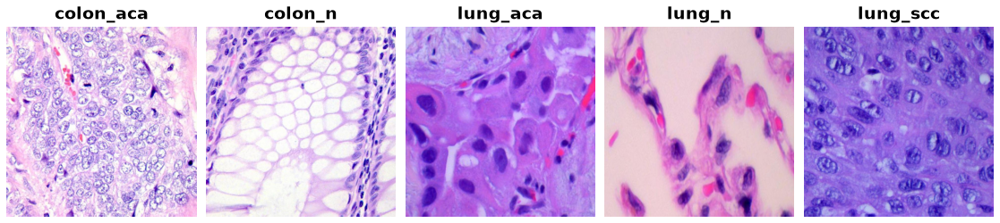

LC25000
=======

.. raw:: html

   

   
   
   
   

Overview
--------

The Lung and Colon Cancer Histopathological Image Dataset (LC25000) has 25,000 color histopathology images of 768x768 pixels. There are five balanced classes of 5,000 images: colon adenocarcinoma, benign colon tissue, lung adenocarcinoma, benign lung tissue and lung squamous cell carcinoma.

The images were made from 1,250 original tiles (250 per class) by random rotations and flips, so each tile has about 20 near identical copies. A random split puts copies of the same tile in train and test, and accuracy then comes out close to 100%. This builder uses the LC25000-clean tile groups (Batchkala et al., 2024), which assign every image to one of 1,246 original tiles. 20% of the groups of each class are held out for test with a fixed seed (0), and all copies of a tile are in the same split. Each example has a ``group_id`` so the split can be checked.

.. list-table::
   :header-rows: 1
   :widths: 25 15 15 15 15 15

   * - Split
     - colon_aca
     - colon_n
     - lung_aca
     - lung_n
     - lung_scc
   * - Train (996 tiles)
     - 3,993 (199)
     - 3,980 (206)
     - 3,973 (194)
     - 4,020 (199)
     - 3,974 (198)
   * - Test (250 tiles)
     - 1,007 (50)
     - 1,020 (51)
     - 1,027 (49)
     - 980 (50)
     - 1,026 (50)

The groups follow the original tile, not the patient. LC25000 does not publish patient ids, so tiles from one patient can still be in both splits.

Data Structure
--------------

Each example ``ds[i]`` is a dictionary with these keys:

.. list-table::
   :header-rows: 1
   :widths: 20 20 60

   * - Key
     - Type
     - Description
   * - ``image``
     - ``PIL.Image.Image``
     - 768x768 RGB image
   * - ``label``
     - int
     - 0 colon_aca, 1 colon_n, 2 lung_aca, 3 lung_n, 4 lung_scc
   * - ``group_id``
     - int
     - LC25000-clean id of the original tile

Usage Example
-------------

.. code-block:: python

    from stable_datasets.images import LC25000

    ds_train = LC25000(split="train")
    ds_test = LC25000(split="test")

    sample = ds_train[0]
    print(sample["label"], sample["group_id"])

References
----------

The images are hosted on Kaggle at https://www.kaggle.com/datasets/andrewmvd/lung-and-colon-cancer-histopathological-images under the CC BY-SA 4.0 license, and the original release is at https://github.com/tampapath/lung_colon_image_set. The tile groups come from LC25000-clean (https://github.com/GeorgeBatch/LC25000-clean), downloaded from https://www.kaggle.com/datasets/gbatchkala/lc25000-clean-groups under the CC BY 4.0 license.

Citation
--------

.. code-block:: bibtex

    @article{borkowski2019lc25000,
      title={Lung and Colon Cancer Histopathological Image Dataset (LC25000)},
      author={Borkowski, Andrew A and Bui, Marilyn M and Thomas, L Brannon and Wilson, Catherine P and DeLand, Lauren A and Mastorides, Stephen M},
      journal={arXiv preprint arXiv:1912.12142},
      year={2019}
    }

    @inproceedings{batchkala2024lc25000clean,
      title={Evaluating Histopathology Foundation Models for Few-Shot Tissue Clustering: An Application to LC25000 Augmented Dataset Cleaning},
      author={Batchkala, George and Li, Bin and Rittscher, Jens},
      booktitle={Data Engineering in Medical Imaging (DEMI), MICCAI Workshop},
      year={2024}
    }
