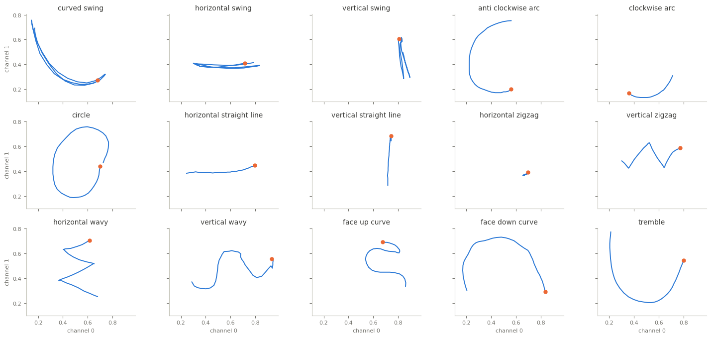

Libras
======

.. raw:: html

   

   
   
   
   
   

Overview
--------

Multivariate time series classification dataset from the UEA archive (Bagnall et al., 2018), from the LIBRAS
Movement Database (Dias et al., 2009). LIBRAS is the Brazilian Sign Language. The database holds curves traced
by the hand in videos of four people over two sessions, time-normalised to 45 frames and given as two
normalised coordinates per frame (2 channels). The teaser plots each example as a curve, channel 0 against
channel 1, with the start marked.

The original database already contains repeated curves (330 distinct of 360), and the archive keeps them:
19 test series also occur in ``train``, with the same label, and each split has a few duplicates. This
favours nearest-neighbour methods; the loader passes the archive's data through unchanged, so results stay
comparable with the literature.

- **Train**: 180 recordings (12 per class).
- **Test**: 180 recordings (12 per class).

The archive labels the movements ``1`` to ``15`` and documents their types; the class names follow that order:
``curved_swing``, ``horizontal_swing``, ``vertical_swing``, ``anti_clockwise_arc``, ``clockwise_arc``,
``circle``, ``horizontal_straight_line``, ``vertical_straight_line``, ``horizontal_zigzag``,
``vertical_zigzag``, ``horizontal_wavy``, ``vertical_wavy``, ``face_up_curve``, ``face_down_curve``,
``tremble``.

Data Structure
--------------

.. list-table::
   :header-rows: 1
   :widths: 20 20 60

   * - Key
     - Type
     - Description
   * - ``series``
     - list of list of float32
     - Hand movement curve, shape ``(45, 2)``: time steps by channels
   * - ``label``
     - int
     - Movement type (0-14)

Usage Example
-------------

.. code-block:: python

    import numpy as np
    from stable_datasets.timeseries import Libras

    train = Libras(split="train")
    sample = train[0]
    x = np.asarray(sample["series"])  # (45, 2)
    print(x.shape, train.features["label"].names[sample["label"]])

References
----------

- Homepage: https://timeseriesclassification.com/description.php?Dataset=Libras
- Archive record: https://doi.org/10.5281/zenodo.11206239
- Original data: https://archive.ics.uci.edu/dataset/181/libras+movement
- Original paper: https://doi.org/10.1109/IJCNN.2009.5178917
- License: CC BY 4.0

Citation
--------

.. code-block:: bibtex

    @inproceedings{dias2009hand,
      title={Hand Movement Recognition for Brazilian Sign Language: A Study Using Distance-Based Neural Networks},
      author={Dias, Daniel B. and Madeo, Renata C. B. and Rocha, Thiago and Bíscaro, Helton H. and Peres, Sarajane M.},
      booktitle={2009 International Joint Conference on Neural Networks},
      pages={697--704},
      year={2009}
    }

    @article{bagnall2018uea,
      title={The UEA multivariate time series classification archive, 2018},
      author={Bagnall, Anthony and Dau, Hoang Anh and Lines, Jason and Flynn, Michael and Large, James and Bostrom, Aaron and Southam, Paul and Keogh, Eamonn},
      journal={arXiv preprint arXiv:1811.00075},
      year={2018}
    }
