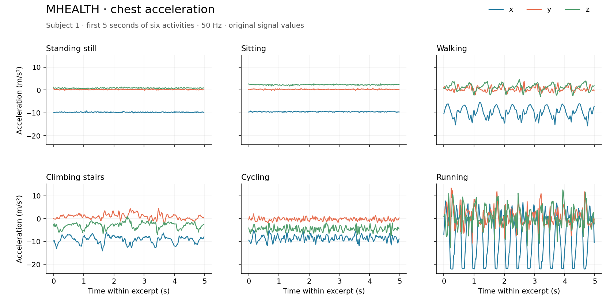

MHEALTH
========

Overview
--------

``MHEALTH`` loads continuous recordings from ten participants performing twelve
activities. Sensors on the chest, left ankle and right lower arm record motion
at 50 Hz; the chest sensor also records two ECG leads. All 23 signal channels,
sample-level labels and original subject identifiers are retained.

The figure shows the first five seconds of each of six selected activities for
subject 1. Time starts at zero in each excerpt; the panels are not consecutive.
The builder itself returns the full recordings, including null-label samples.

Split
-----

There is no official train/validation/test partition. Following the repository
convention, all ten recordings are exposed in a single ``train`` split. This name
does not designate an official training partition. There are 1,215,745 samples
in total; recording lengths vary from 98,304 to 161,280 samples.

Data Structure
--------------

Each example corresponds to one subject:

* ``series``: a nested list of float32 values with shape ``(T, 23)``.
* ``label``: a list of ``T`` integers, preserving source labels 0 through 12.
* ``subject_id``: the original subject identifier, from 1 to 10.

The channel order is:

* Chest acceleration x/y/z, then ECG leads 1 and 2.
* Left-ankle acceleration x/y/z, gyroscope x/y/z and magnetometer x/y/z.
* Right-lower-arm acceleration x/y/z, gyroscope x/y/z and magnetometer x/y/z.

``MHEALTH.CHANNEL_NAMES`` exposes this order. Source units are m/s² for
acceleration, degrees/s for gyroscopes, local units for magnetic field and mV for
ECG. The source README repeats column number 13; the ankle magnetometer occupies
columns 12 through 14 (one-based).

Label 0 is the null class. Labels 1 through 12 are standing still, sitting and
relaxing, lying down, walking, climbing stairs, waist bends forward, frontal
elevation of arms, knees bending, cycling, jogging, running and jumping front
and back. The builder does not filter, normalize, window or join recordings.

Usage
-----

.. code-block:: python

   import numpy as np
   from stable_datasets.timeseries import MHEALTH

   recordings = MHEALTH(split="train")
   record = recordings[0]
   signals = np.asarray(record["series"], dtype=np.float32)
   labels = np.asarray(record["label"])
   print(record["subject_id"], signals.shape, labels.shape)

Pass ``download_dir`` and ``processed_cache_dir`` to choose the raw-download and
Arrow-cache locations, or set ``STABLE_DATASETS_CACHE_DIR`` for both. Define any
evaluation partitions explicitly; keep each subject in one partition.

Source and License
------------------

* Homepage: https://archive.ics.uci.edu/dataset/319/mhealth+dataset
* License: CC BY 4.0.

Citation
--------

.. code-block:: bibtex

   @misc{mhealth_2014,
     author = {Banos, Oresti and Garcia, Rafael and Saez, Alejandro},
     title = {MHEALTH},
     year = {2014},
     publisher = {UCI Machine Learning Repository},
     doi = {10.24432/C5TW22},
     url = {https://doi.org/10.24432/C5TW22}
   }

The original study is Banos et al., *mHealthDroid: A Novel Framework for Agile
Development of Mobile Health Applications*, IWAAL 2014.
