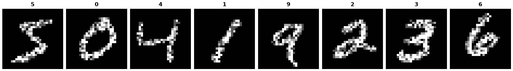
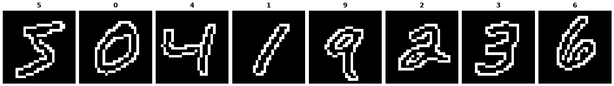

MNIST-C
=======

.. raw:: html

   

   
   
   
   
   

Overview
--------

MNIST-C is a corrupted version of MNIST designed for benchmarking the out-of-distribution robustness of computer vision models. It applies 15 corruptions (noise, blur, affine transforms, digital and weather-like artifacts) to both the MNIST training and test sets, at a single fixed severity per corruption. Labels and image order are identical across corruptions, so every corrupted image can be paired with its clean original.

Each corruption is a separate builder config, selected with ``config_name``. The ``identity`` config is the uncorrupted MNIST reference shipped in the same archive. Every config has the same splits:

- **Train**: 60,000 images
- **Test**: 10,000 images

All images are 28×28 grayscale. The default config is ``shot_noise``.

Data Structure
--------------

When accessing an example using ``ds[i]``, you will receive a dictionary with the following keys:

.. list-table::
   :header-rows: 1
   :widths: 20 20 60

   * - Key
     - Type
     - Description
   * - ``image``
     - ``PIL.Image.Image``
     - 28×28 grayscale corrupted digit image
   * - ``label``
     - int
     - Digit class label (0-9)

Corruption Types
----------------

Configs are listed in the order used by the MNIST-C paper:

**Noise:**
- ``shot_noise``
- ``impulse_noise``

**Blur:**
- ``glass_blur``
- ``motion_blur``

**Affine:**
- ``shear``
- ``scale``
- ``rotate``
- ``translate``

**Digital:**
- ``brightness``
- ``stripe``
- ``dotted_line``
- ``zigzag``
- ``canny_edges``

**Weather:**
- ``fog``
- ``spatter``

**Reference:**
- ``identity`` (clean MNIST, no corruption)

Usage Example
-------------

**Basic Usage**

.. code-block:: python

    from stable_datasets.images.mnist_c import MNISTC

    # Load one corruption (the archive is downloaded once and shared by all configs)
    ds_test = MNISTC(config_name="fog", split="test")

    sample = ds_test[0]
    print(sample.keys())  # {"image", "label"}

    # Optional: make it PyTorch-friendly
    ds_torch = ds_test.with_format("torch")

**Typical Workflow**

.. code-block:: python

    from stable_datasets.images.mnist_c import MNISTC

    # Train on clean MNIST
    train_data = MNISTC(config_name="identity", split="train")
    # ... train your model ...

    # Evaluate robustness on each corruption
    for config in MNISTC.BUILDER_CONFIGS:
        test_data = MNISTC(config_name=config.name, split="test")
        # ... evaluate on corrupted images ...

Robustness Benchmark
--------------------

The SSL benchmark follows the MNIST-C protocol: train on clean data, test on each corruption. The ``mnistc`` benchmark entry pretrains on the clean ``identity`` config and fits the online linear probe alongside it. ``benchmarks/robustness/mnist_c.py`` then reloads that run's frozen backbone and linear probe and reports top-1 accuracy on the clean test set and on each of the 15 corrupted test sets, along with the relative drop from clean accuracy.

.. code-block:: bash

    # 1. Train on clean MNIST-C (identity)
    python -m benchmarks.run model=simclr dataset=mnistc

    # 2. Evaluate the trained backbone + linear probe on every corruption
    python -m benchmarks.robustness.mnist_c \
        --checkpoint <checkpoint.dir>/simclr_vit_small_patch16_224_mnistc/last.ckpt

Accuracy uses the same metric and validation transform as the benchmark's ``eval/linear_probe_top1``, so the clean row reproduces the training run's final linear-probe accuracy.

**Validation results.** SimCLR with a ViT-S/16 backbone, trained from scratch for 150 epochs on clean MNIST-C with the default harness config (batch size 256, one seed, final epoch). The run ends at 96.2% online linear-probe and 93.5% k-NN top-1 on the clean test set. Top-1 is the benchmark's class-balanced ``MulticlassAccuracy``; relative drop is ``1 - top1 / clean_top1``.

.. list-table::
   :header-rows: 1
   :widths: 40 30 30

   * - Corruption
     - Top-1 (%)
     - Relative drop (%)
   * - ``identity`` (clean)
     - 96.22
     - 0.00
   * - ``shot_noise``
     - 64.00
     - 33.49
   * - ``impulse_noise``
     - 28.85
     - 70.02
   * - ``glass_blur``
     - 29.37
     - 69.48
   * - ``motion_blur``
     - 54.75
     - 43.10
   * - ``shear``
     - 91.65
     - 4.75
   * - ``scale``
     - 83.29
     - 13.44
   * - ``rotate``
     - 81.78
     - 15.00
   * - ``brightness``
     - 12.51
     - 87.00
   * - ``translate``
     - 95.83
     - 0.40
   * - ``stripe``
     - 23.80
     - 75.26
   * - ``fog``
     - 11.56
     - 87.98
   * - ``spatter``
     - 60.11
     - 37.53
   * - ``dotted_line``
     - 83.09
     - 13.65
   * - ``zigzag``
     - 52.52
     - 45.41
   * - ``canny_edges``
     - 38.88
     - 59.60
   * - **Mean over 15 corruptions**
     - **54.13**
     - **43.74**

Geometric corruptions (``translate``, ``shear``, ``rotate``, ``scale``) cost little, since the SSL augmentations include crops. Corruptions that change global intensity (``fog``, ``brightness``) or add dense high-frequency patterns (``impulse_noise``, ``glass_blur``, ``stripe``) bring the probe close to chance (10%).

Related Datasets
----------------

- :doc:`cifar10_c`: Corrupted version of CIFAR-10 for robustness evaluation
- :doc:`tiny_imagenet_c`: Corrupted version of Tiny ImageNet for robustness evaluation
- :doc:`e_mnist`: Extended MNIST with handwritten letters and digits

References
----------

- Paper: MNIST-C: A Robustness Benchmark for Computer Vision (https://arxiv.org/abs/1906.02337)
- Code: https://github.com/google-research/mnist-c
- Zenodo: https://zenodo.org/records/3239543
- License: CC BY 4.0

Citation
--------

.. code-block:: bibtex

    @article{mu2019mnist,
      title={MNIST-C: A Robustness Benchmark for Computer Vision},
      author={Mu, Norman and Gilmer, Justin},
      journal={arXiv preprint arXiv:1906.02337},
      year={2019}
    }
