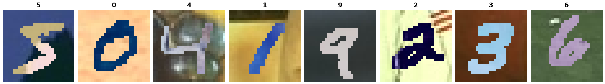

MNIST-M
=======

.. raw:: html

   

   
   
   
   

Overview
--------
MNIST-M was introduced by Ganin & Lempitsky (2015) as the target domain for unsupervised domain adaptation from MNIST. Each image is an MNIST digit blended over a random color patch cropped from the BSDS500 photo collection, using the absolute difference between the digit and the patch. The result keeps MNIST's labels and 28x28 layout but has natural-image color and texture statistics, so models trained only on MNIST transfer poorly to it (57.5% accuracy in the original paper, against 98.9% for a model trained on MNIST-M itself).

- **Train**: 60000 images
- **Test**: 10000 images

The label distribution of both splits is identical to MNIST's.

Data Structure
--------------

When accessing an example using ``ds[i]``, you will receive a dictionary with the following keys:

.. list-table::
   :header-rows: 1
   :widths: 20 20 60

   * - Key
     - Type
     - Description
   * - ``image``
     - ``PIL.Image.Image``
     - 28×28×3 RGB image
   * - ``label``
     - int
     - Digit label (0-9)

Usage Example
-------------

**Basic Usage**

.. code-block:: python

    from stable_datasets.images.mnist_m import MNISTM

    # First run will download + prepare cache, then return the split
    ds = MNISTM(split="train")

    # If you omit the split (split=None), you get a StableDatasetDict with all available splits
    ds_all = MNISTM(split=None)

    sample = ds[0]
    print(sample.keys())  # {"image", "label"}

    # Optional: make it PyTorch-friendly
    ds_torch = ds.with_format("torch")

References
----------

- Data source: https://github.com/liyxi/mnist-m (labeled PyTorch release, files ``mnist_m_train.pt.tar.gz`` with MD5 ``191ed53db9933bd85cc9700558847391`` and ``mnist_m_test.pt.tar.gz`` with MD5 ``e11cb4d7fff76d7ec588b1134907db59``)
- The release is converted from https://github.com/VanushVaswani/keras_mnistm, which reproduces the generation procedure of the DANN paper.
- License: Unknown. The mirror declares no license. The data is derived from MNIST and BSDS500.

Citation
--------

.. code-block:: bibtex

    @inproceedings{ganin2015unsupervised,
        title     = {Unsupervised Domain Adaptation by Backpropagation},
        author    = {Ganin, Yaroslav and Lempitsky, Victor},
        booktitle = {Proceedings of the 32nd International Conference on Machine Learning},
        pages     = {1180--1189},
        year      = {2015}}

    @article{ganin2016domain,
        title     = {Domain-Adversarial Training of Neural Networks},
        author    = {Ganin, Yaroslav and Ustinova, Evgeniya and Ajakan, Hana and Germain, Pascal and Larochelle, Hugo and Laviolette, Fran{\c{c}}ois and Marchand, Mario and Lempitsky, Victor},
        journal   = {Journal of Machine Learning Research},
        volume    = {17},
        number    = {59},
        pages     = {1--35},
        year      = {2016}}
