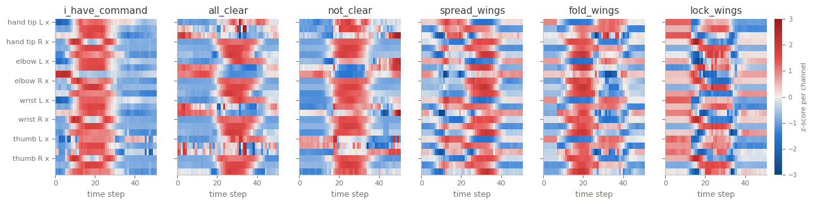

NATOPS
======

.. raw:: html

   

   
   
   
   
   

Overview
--------

Multivariate time series classification dataset from the UEA archive (Bagnall et al., 2018). Each
recording is one of six aircraft handling signals from the Naval Air Training and Operating Procedures
Standardization (NATOPS), captured by sensors on both hand tips, elbows, wrists and thumbs: the x, y and z
coordinates of the eight locations (24 channels) over 51 steps. The data comes from the AALTD 2016 challenge
(Ghouaiel et al., 2017).

Channels follow the archive's order: hand tip left (x, y, z), hand tip right, elbow left, elbow right,
wrist left, wrist right, thumb left, thumb right. The loader passes the archive's data through unchanged.

- **Train**: 180 recordings (30 per class).
- **Test**: 180 recordings (30 per class).

The archive numbers the signals ``1.0`` to ``6.0`` and documents their meaning; the class names follow that
order: ``i_have_command``, ``all_clear``, ``not_clear``, ``spread_wings``, ``fold_wings``, ``lock_wings``.

Data Structure
--------------

.. list-table::
   :header-rows: 1
   :widths: 20 20 60

   * - Key
     - Type
     - Description
   * - ``series``
     - list of list of float32
     - Body sensor recording, shape ``(51, 24)``: time steps by channels
   * - ``label``
     - int
     - Signal class (0-5)

Usage Example
-------------

.. code-block:: python

    import numpy as np
    from stable_datasets.timeseries import NATOPS

    train = NATOPS(split="train")
    sample = train[0]
    x = np.asarray(sample["series"])  # (51, 24)
    print(x.shape, train.features["label"].names[sample["label"]])

References
----------

- Homepage: https://timeseriesclassification.com/description.php?Dataset=NATOPS
- Archive record: https://doi.org/10.5281/zenodo.11206248
- Challenge: https://aaltd16.irisa.fr/challenge/
- Original paper: https://doi.org/10.1504/IJAPR.2017.085315
- License: CC BY 4.0

Citation
--------

.. code-block:: bibtex

    @article{ghouaiel2017continuous,
      title={Continuous pattern detection and recognition in stream - a benchmark for online gesture recognition},
      author={Ghouaiel, Nehla and Marteau, Pierre-François and Dupont, Marc},
      journal={International Journal of Applied Pattern Recognition},
      volume={4},
      number={2},
      year={2017}
    }

    @article{bagnall2018uea,
      title={The UEA multivariate time series classification archive, 2018},
      author={Bagnall, Anthony and Dau, Hoang Anh and Lines, Jason and Flynn, Michael and Large, James and Bostrom, Aaron and Southam, Paul and Keogh, Eamonn},
      journal={arXiv preprint arXiv:1811.00075},
      year={2018}
    }
