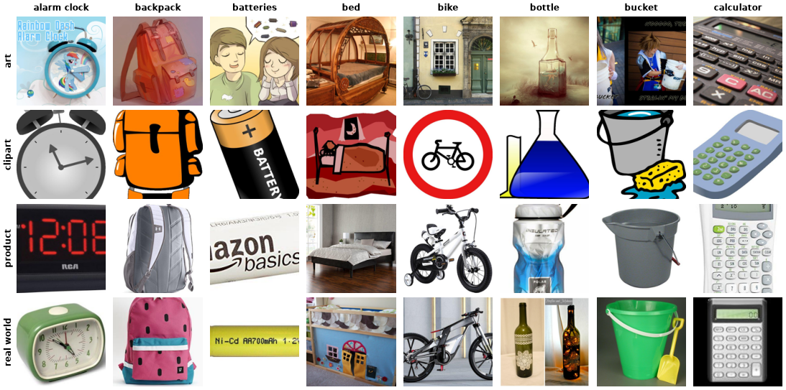

Office-Home
===========

.. raw:: html

   

   
   
   
   
   

Overview
--------

Office-Home is a domain adaptation and domain generalization benchmark with 15,588 images of 65 everyday objects found in
offices and homes (alarm clock, backpack, laptop, mug, ...). Every class appears in four domains. Compared to PACS it has many
more classes and few images per (domain, class) pair, which makes it a harder fine-grained transfer task.

.. list-table::
   :header-rows: 1
   :widths: 30 50 20

   * - Domain
     - Content
     - Images
   * - art
     - Paintings, sketches and artistic depictions
     - 2,427
   * - clipart
     - Clip art images
     - 4,365
   * - product
     - Product photos without background
     - 4,439
   * - real_world
     - Regular camera photos
     - 4,357
   * - **Total**
     -
     - **15,588**

Dataset Configurations
----------------------

The original release (``OfficeHomeDataset_10072016.zip``) has no official train/test split, so the builder offers
two protocols.

**random (default)**

A stratified 80/20 train/test split inside every (domain, class) pair, so every domain and class appears in both splits.
Images are assigned by a SHA-256 hash of their bytes, so the split is reproducible and does not depend on file order.
Use this config as an in-distribution benchmark.

**art, clipart, product, real_world (leave-one-domain-out)**

``train`` holds every image from the other three domains, ``test`` holds every image from the named domain.
This is the standard domain generalization protocol: the model never sees the test domain during training.

Data Structure
--------------

When accessing an example using ``ds[i]``, you will receive a dictionary with the following keys:

.. list-table::
   :header-rows: 1
   :widths: 20 20 60

   * - Key
     - Type
     - Description
   * - ``image``
     - ``PIL.Image.Image``
     - Variable resolution RGB image (non-RGB inputs are converted)
   * - ``label``
     - int
     - Class label (0-64)
   * - ``domain``
     - int
     - Domain index (0: art, 1: clipart, 2: product, 3: real_world)

Usage Example
-------------

**Basic Usage (random split)**

.. code-block:: python

    from stable_datasets.images import OfficeHome

    ds_train = OfficeHome(split="train")
    ds_test = OfficeHome(split="test")

    sample = ds_train[0]
    print(sample.keys())  # {"image", "label", "domain"}
    print(ds_train.features["label"].names[sample["label"]])

    ds_torch = ds_train.with_format("torch")

**Leave-One-Domain-Out**

.. code-block:: python

    from stable_datasets.images import OfficeHome

    # Train on art, product and real_world; evaluate on clipart
    ds_train = OfficeHome(config_name="clipart", split="train")
    ds_test = OfficeHome(config_name="clipart", split="test")
    print(len(ds_train), len(ds_test))  # 11223 4365

References
----------

- Official website and download: https://www.hemanthdv.org/officeHomeDataset.html
- Paper: https://arxiv.org/abs/1706.07522
- License: fair-use notice, non-commercial research and educational use only (see the official website)

Citation
--------

.. code-block:: bibtex

    @inproceedings{venkateswara2017deep,
      title     = {Deep Hashing Network for Unsupervised Domain Adaptation},
      author    = {Venkateswara, Hemanth and Eusebio, Jose and Chakraborty, Shayok and Panchanathan, Sethuraman},
      booktitle = {Proceedings of the IEEE Conference on Computer Vision and Pattern Recognition (CVPR)},
      pages     = {5018--5027},
      year      = {2017}
    }
