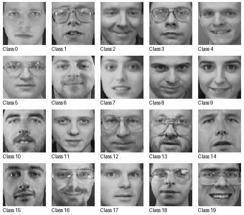

Olivetti Faces
==============

Overview
--------

Olivetti Faces is a grayscale face classification dataset containing
400 images from 40 individuals, with 10 images per individual.
Each image has a resolution of 64 x 64 pixels.

This builder uses a deterministic split defined by this contribution:

- **Train**: 320 images (8 per individual).
- **Test**: 80 images (2 per individual).
- **Classes**: 40 identity labels, numbered 0 through 39.

The first 8 images of each identity are assigned to training, and
the remaining 2 are assigned to testing. This is not an official
train/test split provided by the original dataset.

Data Structure
--------------

Each example contains the following fields:

.. list-table::
   :header-rows: 1
   :widths: 20 25 55

   * - Key
     - Type
     - Description
   * - ``image``
     - ``PIL.Image.Image``
     - 64 x 64 grayscale face image
   * - ``label``
     - int
     - Identity label from 0 to 39

Usage Example
-------------

.. code-block:: python

    from stable_datasets.images import OlivettiFaces

    train_ds = OlivettiFaces(split="train")
    test_ds = OlivettiFaces(split="test")

    sample = train_ds[0]

    print("Training images:", len(train_ds))
    print("Testing images:", len(test_ds))
    print("Image size:", sample["image"].size)
    print("Identity label:", sample["label"])

Dataset Details
---------------

- **Task**: Image classification / face identification
- **Image size**: 64 x 64
- **Image mode**: Grayscale
- **Total images**: 400
- **Number of classes**: 40
- **Original format**: MATLAB MAT file
- **Splitting**: Deterministic, stratified 8/2 per identity
- **Downloading**: Automatic through the dataset builder

Validation
----------

All 400 images and labels were compared with their original source
entries. The training and test source indices were verified to be
disjoint.

A 1-nearest-neighbor classifier achieved 88.75% accuracy on the
80-image test split (71 correct predictions). This is a basic
classification validation experiment, not a benchmark claim.

References
----------

- scikit-learn dataset description:
  https://scikit-learn.org/stable/datasets/real_world.html#olivetti-faces-dataset
- Original data file:
  https://ndownloader.figshare.com/files/5976027

Citation
--------

.. code-block:: bibtex

    @misc{olivettifaces,
        title={The Olivetti Faces Dataset},
        howpublished={AT&T Laboratories Cambridge}
    }

License Information
-------------------

The original dataset is attributed to AT&T Laboratories Cambridge.
The source documentation requests attribution when using the images,
but does not specify an explicit license for the dataset itself.

The dataset license is therefore recorded as Unknown. This does not
imply that the dataset is in the public domain or available for
unrestricted redistribution.
