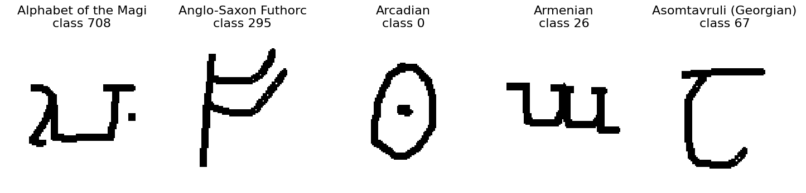

Omniglot
========

.. raw:: html

   

   
   
   
   

`Omniglot <https://github.com/brendenlake/omniglot>`_ contains handwritten
characters from 50 alphabets, with 20 drawings for each of 1,623 characters.
This builder downloads the original image archives at commit
``057f034baf2ecb8530bc5710e5a23584d2a519cc``, with SHA-256 verification.

   One image from each of the first five background alphabets in alphabetical
   order, taking the first PNG filename in each alphabet's sorted paths.
   Titles show the alphabet and global class ID. Original 105 x 105 images are
   enlarged for display using nearest-neighbor interpolation.

Splits and evaluation
---------------------

.. list-table::
   :header-rows: 1

   * - Split
     - Alphabets
     - Character classes
     - Images
   * - ``background``
     - 30
     - 964
     - 19,280
   * - ``evaluation``
     - 20
     - 659
     - 13,180

The official alphabet partition is preserved. Background and evaluation have
disjoint classes. A classifier trained on background class IDs cannot be
evaluated as an ordinary closed-set classifier on evaluation class IDs.
Use background data for representation learning or model selection, then use
support/query tasks involving evaluation characters for few-shot evaluation.
Do not tune on the evaluation alphabets.

The loader preserves the 105 x 105 pixels and black-ink/white-paper polarity.
It converts the source PNG mode ``1`` losslessly to mode ``L`` (uint8 values
0 and 255), so the library's torch formatter returns the expected [0, 1]
range. No resizing, rotations, augmentation, or new data partition occurs.
The stroke sequences and minimal-background variants are not included.

Usage
-----

.. code-block:: python

   from stable_datasets.images import Omniglot

   datasets = Omniglot()
   background = datasets["background"]
   evaluation = datasets["evaluation"]
   row = evaluation[0]
   print(row["alphabet"], row["character"], row["label"])
   tensor = evaluation.with_format("torch")[0]["image"]  # (1, 105, 105), [0, 1]

Fields
------

* ``image``: grayscale PIL image.
* ``label``: released filename's character number minus one. Background IDs
  are 0--963 and evaluation IDs are 964--1622; IDs do not restart in each split.
* ``alphabet``: original alphabet directory name.
* ``character``: alphabet-qualified directory, e.g. ``Angelic/character01``.
  The bare ``character01`` name is not globally unique.
* ``example_id``: the filename suffix, 1--20. This is a drawing index,
  not a globally identified writer.
* ``filename``: original path relative to the split's image root.

Validation
----------

.. code-block:: bash

   pytest stable_datasets/tests/images/test_omniglot.py -m "not large"
   pytest stable_datasets/tests/images/test_omniglot.py -m large
   python examples/validate_qmnist_omniglot.py omniglot --output omniglot_validation.json
   python examples/validate_qmnist_omniglot.py omniglot --omniglot-method cnn --output omniglot_cnn.json

The example uses the authors' 20 fixed within-alphabet, 20-way one-shot tasks.
It verifies every task image against a decoded evaluation sample from this
builder, then uses the authors' Modified Hausdorff Distance nearest-neighbor
baseline. This nonparametric baseline has no learned weights or training
epochs. It does not replace the official tasks with randomly generated ones.

The optional ``cnn`` baseline trains a small supervised network on the 964
background classes, then uses its 64-dimensional features and Euclidean nearest
neighbors on the same official tasks. Only this example resizes inputs to 28 x
28 using bilinear interpolation; stored data remain unchanged. Default training
choices are 5 epochs, Adam at 0.001, batch size 256, and seed 0. These are explicit
lightweight validation choices, not the paper's model or tuned hyperparameters.
The final model is evaluated once, without evaluation-based model selection.

License and citation
--------------------

The official repository carries an
`MIT license <https://github.com/brendenlake/omniglot/blob/master/LICENSE>`_.
Please cite Brenden M. Lake, Ruslan Salakhutdinov, and Joshua B. Tenenbaum,
*Human-level concept learning through probabilistic program induction*,
Science 350(6266), 1332--1338 (2015), doi:10.1126/science.aab3050.
