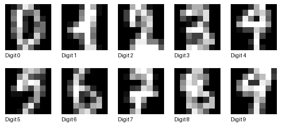

UCI Optdigits
=============

Overview
--------

The Optical Recognition of Handwritten Digits (Optdigits) dataset
contains 5,620 handwritten digit samples across 10 classes (0-9).

Each sample consists of 64 intensity features representing an
8 x 8 grayscale image.

The builder preserves the original UCI training and test splits:

- **Train**: 3,823 samples.
- **Test**: 1,797 samples.
- **Classes**: 10 digit labels, numbered 0 through 9.

Data Structure
--------------

Each example contains the following fields:

.. list-table::
   :header-rows: 1
   :widths: 20 25 55

   * - Key
     - Type
     - Description
   * - ``image``
     - ``PIL.Image.Image``
     - 8 x 8 grayscale handwritten digit image
   * - ``label``
     - int
     - Digit label from 0 to 9

Usage Example
-------------

.. code-block:: python

    from stable_datasets.images import Optdigits

    train_ds = Optdigits(split="train")
    test_ds = Optdigits(split="test")

    sample = train_ds[0]

    print("Training samples:", len(train_ds))
    print("Testing samples:", len(test_ds))
    print("Image size:", sample["image"].size)
    print("Digit label:", sample["label"])

Dataset Details
---------------

- **Task**: Image classification / handwritten digit recognition
- **Image size**: 8 x 8
- **Image mode**: Grayscale
- **Total samples**: 5,620
- **Number of classes**: 10
- **Original feature count**: 64
- **Original pixel intensity range**: 0-16
- **Output pixel intensity range**: 0-255
- **Splitting**: Official UCI train/test files
- **Downloading**: Automatic through the dataset builder

The original 64 features are reshaped into an 8 x 8 array.
Pixel intensities are scaled by 255/16, rounded to the nearest
integer, and converted to unsigned 8-bit grayscale pixels.

Validation
----------

All 5,620 images and labels were compared with their corresponding
entries in the original UCI training and test files.

A 1-nearest-neighbor classifier achieved 97.89% accuracy on the
1,797-sample test split (1,759 correct predictions). This is a basic
classification validation experiment, not a benchmark claim.

References
----------

- UCI Machine Learning Repository:
  https://archive.ics.uci.edu/dataset/80/optical+recognition+of+handwritten+digits
- Original training file:
  https://archive.ics.uci.edu/ml/machine-learning-databases/optdigits/optdigits.tra
- Original test file:
  https://archive.ics.uci.edu/ml/machine-learning-databases/optdigits/optdigits.tes

Citation
--------

.. code-block:: bibtex

    @misc{uci_optdigits,
        title={Optical Recognition of Handwritten Digits},
        author={Alpaydin, E. and Kaynak, C.},
        year={1998},
        publisher={UCI Machine Learning Repository}
    }
