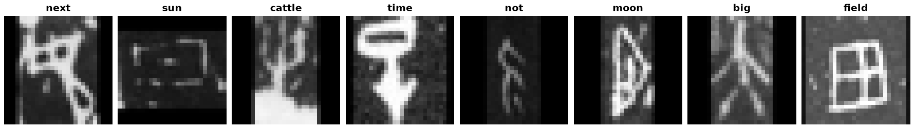

Oracle-MNIST
============

.. raw:: html

   

   
   
   
   

Overview
--------

The Oracle-MNIST dataset contains ancient Chinese oracle-bone characters, about 3,000 years old, from 10 categories. Heavy noise and distortion from burial and aging, along with highly varied writing styles, make classification harder than MNIST. Like MNIST, it uses gzipped IDX files containing 28x28 grayscale uint8 images and integer labels.

- **Train**: 27,222 images
- **Test**: 3,000 images (300 per class)

Data Structure
--------------

When accessing an example using ``ds[i]``, you will receive a dictionary with the following keys:

.. list-table::
   :header-rows: 1
   :widths: 20 20 60

   * - Key
     - Type
     - Description
   * - ``image``
     - ``PIL.Image.Image``
     - 28x28 grayscale image with uint8 pixel values
   * - ``label``
     - int
     - Character class label (0-9)

Character Classes
-----------------

Class names follow the label order in Table 2 of the paper:

.. list-table::
   :header-rows: 1
   :widths: 15 35 25 25

   * - Label
     - Class Name
     - Train
     - Test
   * - 0
     - big
     - 2,433
     - 300
   * - 1
     - sun
     - 2,765
     - 300
   * - 2
     - moon
     - 2,668
     - 300
   * - 3
     - cattle
     - 2,614
     - 300
   * - 4
     - next
     - 2,610
     - 300
   * - 5
     - field
     - 2,328
     - 300
   * - 6
     - not
     - 2,710
     - 300
   * - 7
     - arrow
     - 2,360
     - 300
   * - 8
     - time
     - 3,335
     - 300
   * - 9
     - wood
     - 3,399
     - 300

Usage Example
-------------

.. code-block:: python

    from stable_datasets.images import OracleMNIST

    # First run will download and prepare the dataset cache
    train_ds = OracleMNIST(split="train")
    test_ds = OracleMNIST(split="test")

    sample = train_ds[0]
    print(sample.keys())  # {"image", "label"}

    class_names = train_ds.info.features["label"].names
    print(class_names[sample["label"]])

    # Optional: make it PyTorch-friendly
    train_torch = train_ds.with_format("torch")

Related Datasets
----------------

- **MNIST**: Original handwritten digit dataset with the same format and dimensions
- **KMNIST**: Kuzushiji-MNIST, a drop-in replacement with cursive Japanese characters
- **Fashion-MNIST**: Drop-in replacement with clothing images

References
----------

- Homepage: https://github.com/wm-bupt/oracle-mnist
- License: Apache-2.0
- Downloads are pinned to commit ``b6cb263f84d39a8bbb94c5b806d846b600068924`` and verified with SHA-256 checksums.

Citation
--------

.. code-block:: bibtex

    @article{wang2024dataset,
      title={A dataset of oracle characters for benchmarking machine learning algorithms},
      author={Wang, Mei and Deng, Weihong},
      journal={Scientific Data},
      volume={11},
      number={1},
      pages={87},
      year={2024}
    }
