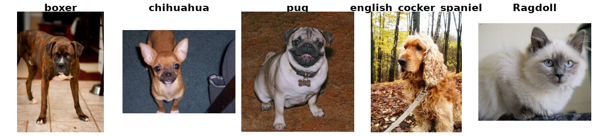

Oxford-IIIT Pet
================

.. raw:: html

   

   
   
   
   

Overview
--------

The Oxford-IIIT Pet dataset is a 37-category pet image dataset (12 cat
breeds, 25 dog breeds) with roughly 200 images per class. Images vary
widely in scale, pose, and lighting, making it a standard fine-grained
classification and linear-probe transfer benchmark.

- **Train** (``trainval``): 3,680 images
- **Test**: 3,669 images

This builder only consumes the per-image breed label; the upstream
annotation archive also ships trimap segmentations and bounding boxes,
which are not exposed here.

Data Structure
--------------

When accessing an example using ``ds[i]``, you will receive a dictionary
with the following keys:

.. list-table::
   :header-rows: 1
   :widths: 20 20 60

   * - Key
     - Type
     - Description
   * - ``image``
     - ``PIL.Image.Image``
     - RGB image (variable dimensions)
   * - ``label``
     - int
     - Breed label (0-36), equal to the official class id minus 1

Usage Example
--------------

.. code-block:: python

    from stable_datasets.images.oxford_iiit_pet import OxfordIIITPet

    ds = OxfordIIITPet(split="train")

    sample = ds[0]
    print(sample.keys())  # {"image", "label"}

    class_names = ds.info.features["label"].names
    print(class_names[sample["label"]])

    # Optional: make it PyTorch-friendly
    ds_torch = ds.with_format("torch")

References
----------

- Official website: https://www.robots.ox.ac.uk/~vgg/data/pets/
- Paper: Cats and Dogs (CVPR 2012)
- License: CC BY-SA 4.0 (copyright of the images remains with their original owners)

Citation
--------

.. code-block:: bibtex

    @inproceedings{parkhi12a,
      title={Cats and Dogs},
      author={Parkhi, O. M. and Vedaldi, A. and Zisserman, A. and Jawahar, C. V.},
      booktitle={IEEE Conference on Computer Vision and Pattern Recognition},
      year={2012}
    }
