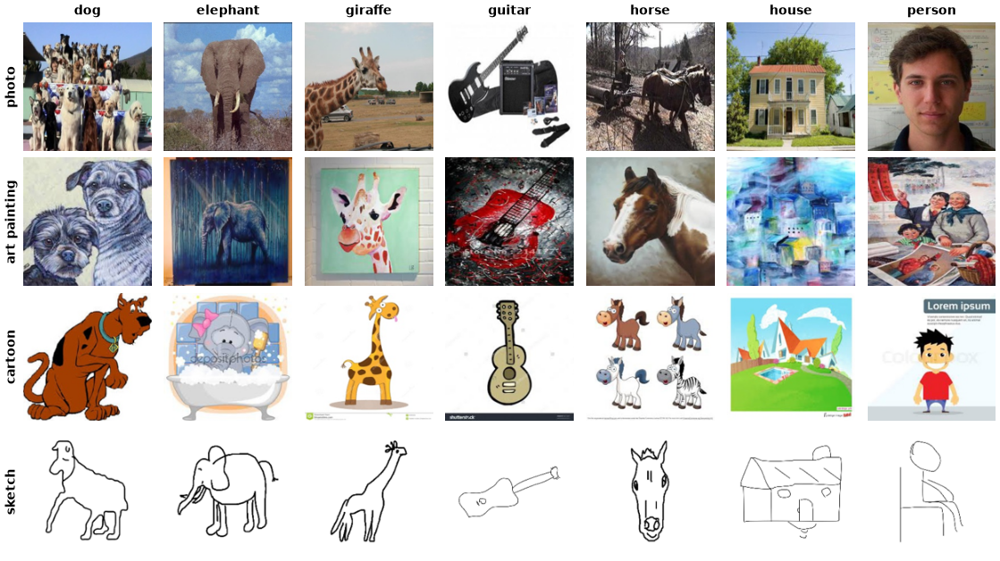

PACS
====

.. raw:: html

   

   
   
   
   
   

Overview
--------

PACS (Photo, Art painting, Cartoon, Sketch) is a domain generalization benchmark with 9,991 images of 7 object classes:
dog, elephant, giraffe, guitar, horse, house and person. Every class appears in four visual domains, and the shift between
domains is large: photos and art paintings are textured and colorful, while sketches are sparse black-and-white line drawings.

.. list-table::
   :header-rows: 1
   :widths: 30 20

   * - Domain
     - Images
   * - photo
     - 1,670
   * - art_painting
     - 2,048
   * - cartoon
     - 2,344
   * - sketch
     - 3,929
   * - **Total**
     - **9,991**

Dataset Configurations
----------------------

The original release comes with an official train/validation split for every domain
(``<domain>_train_kfold.txt`` and ``<domain>_crossval_kfold.txt``, about 90/10), and its readme asks that this split
be used for fair comparisons. The configs follow it:

**all (default)**

``train`` and ``validation`` are the official splits of all four domains. There is no ``test`` split.

**photo, art_painting, cartoon, sketch (leave-one-domain-out)**

``train`` and ``validation`` are the official splits of the other three domains, and ``test`` is every image of the
named domain (``<domain>_test_kfold.txt``). This is the protocol of the original paper: the model never sees the
test domain, and model selection uses the source-domain validation split only.

Data Structure
--------------

When accessing an example using ``ds[i]``, you will receive a dictionary with the following keys:

.. list-table::
   :header-rows: 1
   :widths: 20 20 60

   * - Key
     - Type
     - Description
   * - ``image``
     - ``PIL.Image.Image``
     - 227x227 RGB image (sketches are converted to RGB on a white background)
   * - ``label``
     - int
     - Class label (0-6)
   * - ``domain``
     - int
     - Domain index (0: photo, 1: art_painting, 2: cartoon, 3: sketch)

Usage Example
-------------

**All domains**

.. code-block:: python

    from stable_datasets.images import PACS

    ds_train = PACS(split="train")
    ds_val = PACS(split="validation")

    sample = ds_train[0]
    print(sample.keys())  # {"image", "label", "domain"}
    print(ds_train.features["domain"].names[sample["domain"]])

    ds_torch = ds_train.with_format("torch")

**Leave-One-Domain-Out**

.. code-block:: python

    from stable_datasets.images import PACS

    # Train on photo, art_painting and cartoon; evaluate on sketch
    ds_train = PACS(config_name="sketch", split="train")
    ds_val = PACS(config_name="sketch", split="validation")
    ds_test = PACS(config_name="sketch", split="test")
    print(len(ds_test))  # 3929

References
----------

- Project page and download: https://dali-dl.github.io/project_iccv2017.html
- Paper: https://arxiv.org/abs/1710.03077

Citation
--------

.. code-block:: bibtex

    @inproceedings{li2017deeper,
      title     = {Deeper, Broader and Artier Domain Generalization},
      author    = {Li, Da and Yang, Yongxin and Song, Yi-Zhe and Hospedales, Timothy M.},
      booktitle = {Proceedings of the IEEE International Conference on Computer Vision (ICCV)},
      pages     = {5542--5550},
      year      = {2017}
    }
