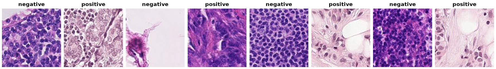

PatchCamelyon
=============

.. raw:: html

   

   
   
   
   
   

Overview
--------

PatchCamelyon (PCam, Veeling et al., 2018) contains 327,680 96×96 RGB patches extracted from the
Camelyon16 lymph node whole-slide images (WSIs). A patch is labeled ``positive`` if its center 32×32
region contains metastatic tumor tissue. The official splits come from disjoint sets of slides:

- Train: 262,144 patches
- Validation: 32,768 patches (``valid`` in the release)
- Test: 32,768 patches

Data Structure
--------------

When accessing an example using ``ds[i]``, you will receive a dictionary with the following keys:

.. list-table::
   :header-rows: 1
   :widths: 20 20 60

   * - Key
     - Type
     - Description
   * - ``image``
     - ``PIL.Image.Image``
     - 96×96×3 RGB patch
   * - ``label``
     - int
     - ``0`` = ``negative``, ``1`` = ``positive`` (tumor tissue in the center 32×32 region)
   * - ``wsi``
     - str
     - Source slide, e.g. ``camelyon16_train_tumor_104`` or ``camelyon16_test_032``
   * - ``coord_x``
     - int
     - Horizontal position of the patch in the source slide
   * - ``coord_y``
     - int
     - Vertical position of the patch in the source slide
   * - ``tumor_patch``
     - bool
     - Whether the patch contains tumor tissue anywhere, including outside the center region

The release ships gzipped HDF5 files. While a split's cache is built, its image file is decompressed
next to the download (about 7.3 GB for ``train``) and removed afterwards.

Usage Example
-------------

.. code-block:: python

    from stable_datasets.images import PatchCamelyon

    ds_train = PatchCamelyon(split="train")
    ds_test = PatchCamelyon(split="test")

    sample = ds_train[0]
    print(sample.keys())  # {"image", "label", "wsi", "coord_x", "coord_y", "tumor_patch"}

References
----------

- Project page: https://github.com/basveeling/pcam
- Data (Zenodo): https://zenodo.org/records/2546921
- Paper: https://arxiv.org/abs/1806.03962
- License: CC0 1.0

Citation
--------

.. code-block:: bibtex

    @article{veeling2018rotation,
      title   = {Rotation Equivariant {CNNs} for Digital Pathology},
      author  = {Veeling, Bastiaan S and Linmans, Jasper and Winkens, Jim and Cohen, Taco and Welling, Max},
      journal = {arXiv preprint arXiv:1806.03962},
      year    = {2018}
    }

    @article{bejnordi2017diagnostic,
      title   = {Diagnostic Assessment of Deep Learning Algorithms for Detection of Lymph Node Metastases in Women With Breast Cancer},
      author  = {Ehteshami Bejnordi, Babak and others},
      journal = {JAMA},
      volume  = {318},
      number  = {22},
      pages   = {2199--2210},
      year    = {2017},
      doi     = {10.1001/jama.2017.14585}
    }
