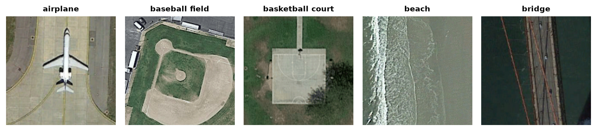

PatternNet
==========

.. raw:: html

   

   
   
   
   

Overview
--------

PatternNet is a large-scale, high-resolution remote sensing benchmark dataset collected from Google Earth and Google Maps imagery across various cities in the United States. It was established for evaluating remote sensing image retrieval and scene classification algorithms.

- **Total Images**: 30,400 images (38 classes, 800 images per class)
- **Resolution**: 256×256 pixels, RGB (stored as the original JPEGs)
- **Source**: the authors' release (``PatternNet.zip``, 1.4 GB), linked from the homepage
- **License**: not stated on the homepage; cite the original paper when using the data

PatternNet has no official train/test split, so stable-datasets uses its own fixed 80/20 split of each class, by the number in the image file names (``airplane001.jpg`` to ``airplane800.jpg``):

- **Train Split**: 24,320 images (images 001-640 of each class)
- **Test Split**: 6,080 images (images 641-800 of each class)

Data Structure
--------------

When accessing an example using ``ds[i]``, you receive a dictionary with the following keys:

.. list-table::
   :header-rows: 1
   :widths: 20 25 55

   * - Key
     - Type
     - Description
   * - ``image``
     - ``PIL.Image.Image``
     - 256×256 RGB remote sensing image
   * - ``label``
     - int
     - Land-use scene class index (0–37)

Classes
-------

The dataset contains 38 distinct land-use categories:
``airplane``, ``baseball field``, ``basketball court``, ``beach``, ``bridge``, ``cemetery``, ``chaparral``, ``christmas tree farm``, ``closed road``, ``coastal mansion``, ``crosswalk``, ``dense residential``, ``ferry terminal``, ``football field``, ``forest``, ``freeway``, ``golf course``, ``harbor``, ``intersection``, ``mobile home park``, ``nursing home``, ``oil gas field``, ``oil well``, ``overpass``, ``parking lot``, ``parking space``, ``railway``, ``river``, ``runway``, ``runway marking``, ``shipping yard``, ``solar panel``, ``sparse residential``, ``storage tank``, ``swimming pool``, ``tennis court``, ``transformer station``, ``wastewater treatment plant``.

Usage Example
-------------

.. code-block:: python

    from stable_datasets.images import PatternNet

    # Load test split
    ds = PatternNet(split="test")
    sample = ds[0]

    print(sample.keys())          # dict_keys(["image", "label"])
    print(type(sample["image"]))  # PIL.Image.Image
    print(sample["image"].size)   # (256, 256)
    print(sample["label"])        # integer class index (0-37)

    # Load as PyTorch tensors
    ds_torch = ds.with_format("torch")
    torch_sample = ds_torch[0]
    print(torch_sample["image"].shape)  # torch.Size([3, 256, 256])

Citation
--------

.. code-block:: bibtex

    @article{zhou2018patternnet,
        title={PatternNet: A benchmark dataset for performance evaluation of remote sensing image retrieval},
        author={Zhou, Weixun and Newsam, Shawn and Li, Congmin and Shao, Zhenfeng},
        journal={ISPRS Journal of Photogrammetry and Remote Sensing},
        volume={145},
        pages={197--209},
        year={2018},
        publisher={Elsevier}
    }
