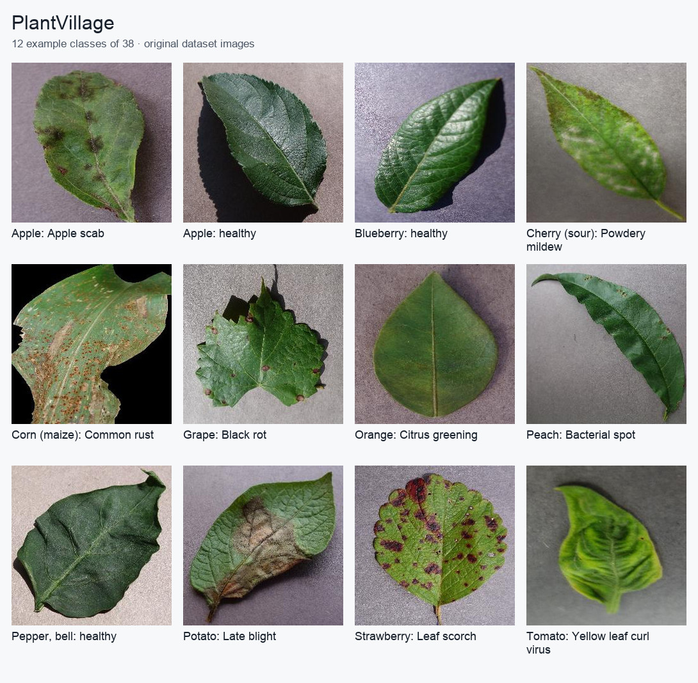

PlantVillage
============

Overview
--------

PlantVillage is an image classification dataset of plant leaves, covering
healthy leaves and a range of plant diseases across 38 categories.

This implementation uses the color images from the original PlantVillage
repository, using the ``color`` configuration. The dataset contains 54,305 images.

Dataset Information
-------------------

.. list-table::
   :header-rows: 1

   * - Property
     - Value
   * - Task
     - Image classification
   * - Number of classes
     - 38
   * - Total images
     - 54,305
   * - Training images
     - 43,596
   * - Test images
     - 10,709
   * - Image format
     - RGB color images

Splits
------

The builder uses the authors' published color-image **80/20 train/test split**:
43,596 training images and 10,709 test images. Membership comes directly from
``splits/color_train.txt`` and ``splits/color_test.txt`` in the authors'
``mohanty/PlantVillage`` distribution. No validation split is provided.

These official lists preserve the authors' leaf-group assignments. The builder
matches their relative image paths against the GitHub archive without
reshuffling, hashing filenames, or creating additional partitions. Archive entry
order and repository-folder prefixes do not affect membership.

The authors' leaf map does not identify every image. Images without an entry
follow the official lists as published; this builder does not infer additional
leaf identities. Tests verify separation of the identified leaf groups and
exact agreement with both manifests.

The downloaded snapshot has 54,305 color images, although the upstream overview
quotes 54,306. Counts here refer to the actual selected archive members.

Usage
-----

.. code-block:: python

    from stable_datasets.images import PlantVillage

    ds_train = PlantVillage(split="train")
    ds_test = PlantVillage(split="test")

    ds_all = PlantVillage(split=None)

    print(len(ds_train))
    print(len(ds_test))

Each example contains:

* ``image``: The plant-leaf image.
* ``label``: An integer class identifier from 0 to 37.

Source
------

* Original repository: https://github.com/spMohanty/PlantVillage-Dataset
* Image archive: https://github.com/spMohanty/PlantVillage-Dataset/archive/refs/heads/master.zip
* Official training manifest: https://huggingface.co/datasets/mohanty/PlantVillage/resolve/main/splits/color_train.txt
* Official test manifest: https://huggingface.co/datasets/mohanty/PlantVillage/resolve/main/splits/color_test.txt

Class mapping
-------------

The following names define the stable zero-based class order:

.. code-block:: text

    0: Apple___Apple_scab
    1: Apple___Black_rot
    2: Apple___Cedar_apple_rust
    3: Apple___healthy
    4: Blueberry___healthy
    5: Cherry_(including_sour)___Powdery_mildew
    6: Cherry_(including_sour)___healthy
    7: Corn_(maize)___Cercospora_leaf_spot Gray_leaf_spot
    8: Corn_(maize)___Common_rust_
    9: Corn_(maize)___Northern_Leaf_Blight
    10: Corn_(maize)___healthy
    11: Grape___Black_rot
    12: Grape___Esca_(Black_Measles)
    13: Grape___Leaf_blight_(Isariopsis_Leaf_Spot)
    14: Grape___healthy
    15: Orange___Haunglongbing_(Citrus_greening)
    16: Peach___Bacterial_spot
    17: Peach___healthy
    18: Pepper,_bell___Bacterial_spot
    19: Pepper,_bell___healthy
    20: Potato___Early_blight
    21: Potato___Late_blight
    22: Potato___healthy
    23: Raspberry___healthy
    24: Soybean___healthy
    25: Squash___Powdery_mildew
    26: Strawberry___Leaf_scorch
    27: Strawberry___healthy
    28: Tomato___Bacterial_spot
    29: Tomato___Early_blight
    30: Tomato___Late_blight
    31: Tomato___Leaf_Mold
    32: Tomato___Septoria_leaf_spot
    33: Tomato___Spider_mites Two-spotted_spider_mite
    34: Tomato___Target_Spot
    35: Tomato___Tomato_Yellow_Leaf_Curl_Virus
    36: Tomato___Tomato_mosaic_virus
    37: Tomato___healthy

Download, cache and RGB behavior
--------------------------------

The builder downloads the two official split manifests and caches the shared
GitHub image ZIP once. It reads selected members directly;
no archive entries are extracted to the filesystem. The first load builds a
processed cache per split. Repeated loads reopen it without downloading.

RGB images retain their original encoded bytes. Other modes, including a source
RGBA PNG, are converted to RGB and encoded as lossless PNG (regardless of the
original filename extension).

The defaults are ``~/.stable-datasets/downloads`` and
``~/.stable-datasets/processed``. Override them explicitly with
``download_dir=...`` and ``processed_cache_dir=...``. ``STABLE_DATASETS_CACHE_DIR``
can relocate the dataset cache root.

Attribution and usage terms
---------------------------

Attribute Mohanty, Hughes and Salathe (2016),
`Using Deep Learning for Image-Based Plant Disease Detection
<https://doi.org/10.3389/fpls.2016.01419>`_. The downloaded GitHub archive contains
no explicit LICENSE file. The authors' current
`Hugging Face card <https://huggingface.co/datasets/mohanty/PlantVillage>`_
declares CC BY-SA 3.0, while its loader comments that the license should be
verified. That card is not treated here as a definitive license grant for every
file in the GitHub snapshot. Check the source's applicable terms before
redistribution. No dataset photographs are redistributed in this documentation.

.. code-block:: bibtex

    @article{Mohanty2016PlantVillage,
      title={Using Deep Learning for Image-Based Plant Disease Detection},
      author={Mohanty, Sharada P. and Hughes, David P. and Salathe, Marcel},
      journal={Frontiers in Plant Science},
      volume={7}, year={2016}, doi={10.3389/fpls.2016.01419}
    }
