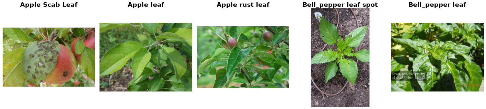

PlantDoc
========

.. raw:: html

   

   
   
   
   

Overview
--------

PlantDoc is a plant disease dataset built from images collected on the internet instead of in a lab, so the leaves are mostly photographed in natural conditions, often with cluttered backgrounds. This builder loads the classification data of the PlantDoc repository: 2,578 images of 13 plant species, one label per image, in 28 classes. Each class is either a healthy leaf or a disease or pest of one species, e.g. *Tomato leaf* and *Tomato leaf late blight*.

- **Train**: 2,342 images
- **Test**: 236 images

There is no official validation split. Image sizes vary a lot, from 130×69 to 4000×6000 pixels.

Data Structure
--------------

When accessing an example using ``ds[i]``, you will receive a dictionary with the following keys:

.. list-table::
   :header-rows: 1
   :widths: 20 20 60

   * - Key
     - Type
     - Description
   * - ``image``
     - ``PIL.Image.Image``
     - RGB image of variable size
   * - ``label``
     - int
     - Class label (0-27)

The class names are the folder names of the dataset repository, kept as they are (including their mixed capitalization, e.g. *Apple Scab Leaf* and *grape leaf*).

Usage Example
-------------

**Basic Usage**

.. code-block:: python

    from stable_datasets.images import PlantDoc

    # First run will download + prepare cache, then return the split
    ds_train = PlantDoc(split="train")
    ds_test = PlantDoc(split="test")

    sample = ds_train[0]
    print(sample.keys())  # {"image", "label"}

    class_names = ds_train.features["label"].names
    print(class_names[sample["label"]])  # Apple Scab Leaf

    # Optional: make it PyTorch-friendly
    ds_train_torch = ds_train.with_format("torch")

Notes
-----

- The repository README calls this data Cropped-PlantDoc, but the images are the whole photos. The paper's Cropped-PlantDoc is a different set of 9,216 leaf crops cut out along the annotated bounding boxes, so its classification results are not comparable with this dataset.
- *Tomato two spotted spider mites leaf* only has 2 training images and none in the test split, so the test split covers 27 of the 28 classes.
- At least 14 of the 236 test images also appear in the training split (11 byte-identical files and 3 re-encoded copies), and 9 of these pairs have different labels in the two splits (for example *Potato leaf early blight* in train and *Potato leaf late blight* in test). The training split also has a byte-identical pair with two different labels. The builder keeps the official split as released.
- 13 training images are PNG, MPO, CMYK or grayscale files, most of them with a ``.jpg`` name. The builder converts them to RGB (stored as PNG) so every example has 3 channels.
- 29 photos store their rotation only in EXIF metadata, which image decoding ignores. The builder saves them upright, re-encoded as JPEG.
- The paper reports 2,598 data points in total; the ``train`` and ``test`` folders of the repository contain 2,578 images.

References
----------

- Homepage: https://github.com/pratikkayal/PlantDoc-Dataset
- Paper: https://arxiv.org/abs/1911.10317
- License: CC BY 4.0

Citation
--------

.. code-block:: bibtex

    @inproceedings{singh2020plantdoc,
      title={PlantDoc: A Dataset for Visual Plant Disease Detection},
      author={Singh, Davinder and Jain, Naman and Jain, Pranjali and Kayal, Pratik and
              Kumawat, Sudhakar and Batra, Nipun},
      booktitle={Proceedings of the 7th ACM IKDD CoDS and 25th COMAD},
      pages={249--253},
      year={2020},
      doi={10.1145/3371158.3371196}
    }
