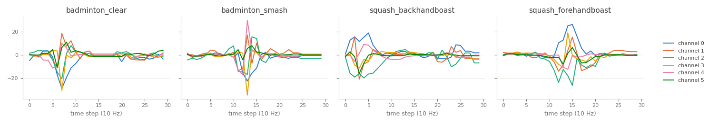

RacketSports
============

.. raw:: html

   

   
   
   
   
   

Overview
--------

Multivariate time series classification dataset from the UEA archive (Bagnall et al., 2018). University students
played badminton or squash while wearing a smart watch, which recorded the x, y and z axes of its gyroscope and its
accelerometer (6 channels) at 10 Hz for 3 seconds. The task is to tell the sport and the stroke: a clear or a smash in
badminton, a forehand or a backhand boast in squash. The data was collected by Phillip Perks as part of an
undergraduate project at the University of East Anglia in 2017/18.

The archive does not document which channels belong to the gyroscope and which to the accelerometer, so the channels
are kept in the archive's order. The loader passes the archive's data through unchanged.

- **Train**: 151 recordings.
- **Test**: 152 recordings.

Class names are the archive's labels in lower case: ``badminton_clear``, ``badminton_smash``,
``squash_backhandboast``, ``squash_forehandboast``.

Data Structure
--------------

.. list-table::
   :header-rows: 1
   :widths: 20 20 60

   * - Key
     - Type
     - Description
   * - ``series``
     - list of list of float32
     - Smart watch recording, shape ``(30, 6)``: time steps by channels
   * - ``label``
     - int
     - Stroke class (0-3)

Usage Example
-------------

.. code-block:: python

    import numpy as np
    from stable_datasets.timeseries import RacketSports

    train = RacketSports(split="train")
    sample = train[0]
    x = np.asarray(sample["series"])  # (30, 6)
    print(x.shape, train.features["label"].names[sample["label"]])

References
----------

- Homepage: https://timeseriesclassification.com/description.php?Dataset=RacketSports
- Archive record: https://doi.org/10.5281/zenodo.11206263
- License: CC BY 4.0

Citation
--------

.. code-block:: bibtex

    @article{bagnall2018uea,
      title={The UEA multivariate time series classification archive, 2018},
      author={Bagnall, Anthony and Dau, Hoang Anh and Lines, Jason and Flynn, Michael and Large, James and Bostrom, Aaron and Southam, Paul and Keogh, Eamonn},
      journal={arXiv preprint arXiv:1811.00075},
      year={2018}
    }
