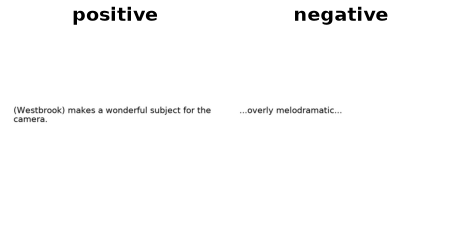

Rendered SST2
=============

.. raw:: html

   

   
   
   
   

Overview
--------

Rendered SST2 contains sentences from the Stanford Sentiment Treebank v2 (SST-2) rendered as images by OpenAI to evaluate CLIP's OCR ability. The task is binary sentiment classification from images of text, with each sentence represented as a 448x448 RGB PNG.

- **Train**: 6,920 images
- **Validation**: 872 images
- **Test**: 1,821 images

Data Structure
--------------

When accessing an example using ``ds[i]``, you will receive a dictionary with the following keys:

.. list-table::
   :header-rows: 1
   :widths: 20 20 60

   * - Key
     - Type
     - Description
   * - ``image``
     - ``PIL.Image.Image``
     - 448x448 RGB image of a sentence
   * - ``label``
     - int
     - Sentiment class label (0: negative, 1: positive)

Sentiment Classes
-----------------

Class labels follow the SST-2 convention:

.. list-table::
   :header-rows: 1
   :widths: 15 25 20 20 20

   * - Label
     - Class Name
     - Train
     - Validation
     - Test
   * - 0
     - negative
     - 3,310
     - 428
     - 912
   * - 1
     - positive
     - 3,610
     - 444
     - 909

Usage Example
-------------

.. code-block:: python

    from stable_datasets.images import RenderedSST2

    # First run will download and prepare the dataset cache
    train_ds = RenderedSST2(split="train")
    val_ds = RenderedSST2(split="validation")
    test_ds = RenderedSST2(split="test")

    sample = train_ds[0]
    print(sample.keys())  # {"image", "label"}

    class_names = train_ds.info.features["label"].names
    print(class_names[sample["label"]])

    # Optional: make it PyTorch-friendly
    train_torch = train_ds.with_format("torch")

Related Datasets
----------------

- **SST-2 (GLUE)**: Text version of the binary sentiment classification task
- **CIFAR-10**: Natural image classification dataset also used to evaluate CLIP
- **Country211**: Geolocation image classification dataset introduced for CLIP evaluation

References
----------

- Homepage: https://github.com/openai/CLIP/blob/main/data/rendered-sst2.md
- License: Unknown. No explicit data license is published for Rendered SST2. The CLIP code repository is MIT-licensed; this does not establish a license for the dataset.
- Download: https://openaipublic.azureedge.net/clip/data/rendered-sst2.tgz (137,767,107 bytes), verified with a SHA-256 checksum. All splits share this archive; the validation split uses its ``valid`` folder.

Citation
--------

.. code-block:: bibtex

    @inproceedings{radford2021learning,
        title={Learning Transferable Visual Models From Natural Language Supervision},
        author={Radford, Alec and Kim, Jong Wook and Hallacy, Chris and Ramesh, Aditya and Goh, Gabriel and Agarwal, Sandhini and Sastry, Girish and Askell, Amanda and Mishkin, Pamela and Clark, Jack and Krueger, Gretchen and Sutskever, Ilya},
        booktitle={International Conference on Machine Learning (ICML)},
        year={2021}}

    @inproceedings{socher2013recursive,
        title={Recursive Deep Models for Semantic Compositionality Over a Sentiment Treebank},
        author={Socher, Richard and Perelygin, Alex and Wu, Jean and Chuang, Jason and Manning, Christopher D. and Ng, Andrew and Potts, Christopher},
        booktitle={Proceedings of the 2013 Conference on Empirical Methods in Natural Language Processing (EMNLP)},
        year={2013}}
