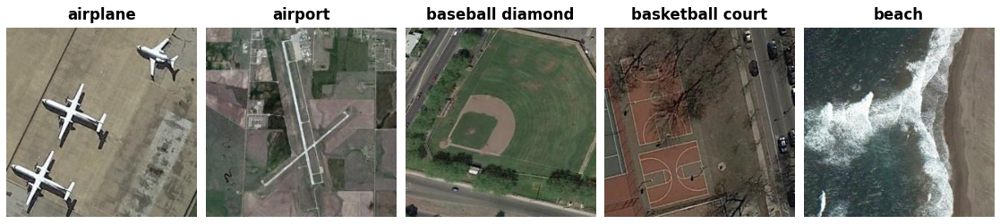

RESISC45
========

.. raw:: html

   

   
   
   
   

Overview
--------
NWPU-RESISC45 is a remote-sensing scene classification benchmark created by
Northwestern Polytechnical University. It contains 31,500 images across 45
scene categories, with 700 images in every class. Images are returned at their
native 256 x 256 pixel size, with RGB channels and no resizing or cropping.

- **Train**: 31,500 images (the entire collection)
- **Classes**: 45; 700 images per class
- **Validation / Test**: Not provided

.. important::

   ``train`` is a storage name for the full collection, not an official training
   partition. The original dataset does not supply a fixed official holdout.
   This reader does not apply partitions introduced by subsequent papers or
   create its own split. Define and record any evaluation partition separately,
   before model selection, and do not evaluate on images used for training.

Data Structure
--------------

.. list-table::
   :header-rows: 1
   :widths: 20 20 60

   * - Key
     - Type
     - Description
   * - ``image``
     - ``PIL.Image.Image``
     - 256 x 256 RGB image
   * - ``label``
     - int
     - Scene label (0-44)

Class IDs follow the fixed alphabetical order of the original class-directory
names, from ``airplane`` to ``wetland``. Multiword names use underscores, such
as ``baseball_diamond``. Examples are ordered by archive path for reproducibility.

Usage Example
-------------

.. code-block:: python

    from stable_datasets.images.resisc45 import RESISC45

    # Downloads the raw archive and prepares the local Arrow cache.
    ds = RESISC45(split="train")
    sample = ds[0]
    print(sample["image"].size)  # (256, 256)
    print(ds.features["label"].int2str(sample["label"]))  # airplane

    ds_all = RESISC45()  # StableDatasetDict containing only "train"
    ds_torch = ds.with_format("torch")

Download and Provenance
-----------------------
The original distribution is a RAR archive. This reader downloads the public
``NWPU-RESISC45.zip`` mirror maintained by Isaac Corley, pinned to revision
``883edc0eee77b2c84225472f10f126e3ed83fa6e``. The approximately 427 MB archive
contains JPEGs under ``NWPU-RESISC45/<class>/<filename>.jpg`` and requires no
account. This is the same archive URL used by
`TorchGeo's RESISC45 reader <https://github.com/microsoft/torchgeo/blob/main/torchgeo/datasets/resisc45.py>`_.
TorchGeo's later-paper train/validation/test lists are not used here.

The ZIP preserves the published class counts and native image resolution.
Mirror availability does not grant additional image-use rights; consult the
original authors and imagery terms for your intended use. No dataset license
is inferred from a hosting service or from the license of reader code.

References
----------

- `Original project homepage <http://www.escience.cn/people/JunweiHan/NWPU-RESISC45.html>`_
- `Original paper <https://doi.org/10.1109/JPROC.2017.2675998>`_
- `Pinned ZIP mirror <https://huggingface.co/datasets/isaaccorley/resisc45/blob/883edc0eee77b2c84225472f10f126e3ed83fa6e/NWPU-RESISC45.zip>`_
- `TensorFlow Datasets collection description <https://www.tensorflow.org/datasets/catalog/resisc45>`_

Citation
--------

.. code-block:: bibtex

    @article{cheng2017remote,
      title={Remote Sensing Image Scene Classification: Benchmark and State of the Art},
      author={Cheng, Gong and Han, Junwei and Lu, Xiaoqiang},
      journal={Proceedings of the IEEE},
      volume={105},
      number={10},
      pages={1865--1883},
      year={2017},
      doi={10.1109/JPROC.2017.2675998}
    }
