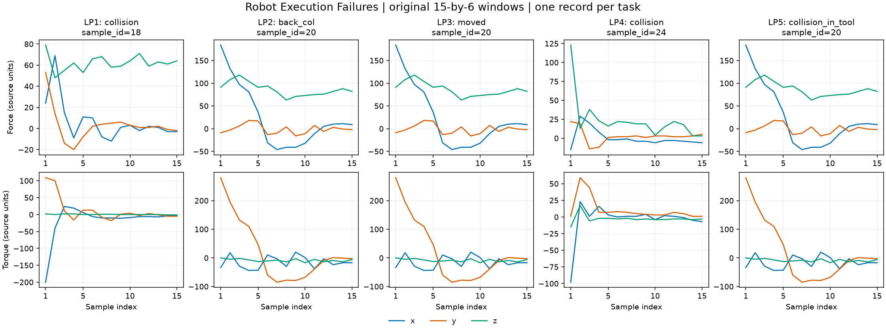

Robot Execution Failures
========================

   The first non-normal record from each task, with original sample IDs
   shown above. Force and torque are plotted separately in source units,
   without normalization. Panel scales differ; sample index is not time.
   Repeated curves across tasks reflect shared records in the original source.

Source and structure
--------------------

`Official UCI source <https://archive.ics.uci.edu/dataset/138/robot+execution+failures>`_
lists CC BY 4.0. Citation: Lopes, L. & Camarinha-Matos, L. (1998),
Robot Execution Failures, UCI Machine Learning Repository,
https://doi.org/10.24432/C5M89N.

Each sample has a time-major float32 ``series`` of shape ``(15, 6)``,
zero-based ``label`` and zero-based ``sample_id`` in original file order.
Channels are Fx, Fy, Fz, Tx, Ty, Tz. The source contains integer-valued measurements;
the loader validates that conversion to float32 is lossless. No normalization,
resampling or windowing is added. The observation window is 315 milliseconds;
no sampling-rate assumption is added.

Five configurations retain the source learning problems and their own label spaces:

* ``lp1`` (default): approach to grasp, 88 records, 4 classes.
* ``lp2``: transfer of a part, 47 records, 5 classes.
* ``lp3``: position after transfer failure, 47 records, 4 classes.
* ``lp4``: approach to ungrasp, 117 records, 3 classes.
* ``lp5``: motion with part, 164 records, 5 classes.

Each exposes only ``all``. The source has no official train/test split or
session/robot identifiers. Do not pool tasks as interchangeable labels.
Some identical signal windows occur across tasks; they are preserved.
Only the selected text member is read; bundled executables are never run.

Usage
-----

.. code-block:: python

    import numpy as np
    from stable_datasets.timeseries import RobotExecutionFailures

    dataset = RobotExecutionFailures(config_name="lp1", split="all")
    signal = np.asarray(dataset[0]["series"], dtype=np.float32)
    labels = RobotExecutionFailures.CLASS_NAMES["lp1"]

All configurations share one checksum-verified raw archive, with separate
processed caches. Nested sequences may remain lists under formatting; convert
explicitly with NumPy or ``torch.as_tensor``.

Evaluation example
------------------

From the repository root::

    python examples/robot_failure_classification.py --output-dir results/robot

The example evaluates a fixed 200-tree random forest against a majority baseline,
using per-channel mean/std/min/max features. Each task is evaluated independently
with three-fold StratifiedGroupKFold, seed 42. Exact duplicate signal windows
are grouped using their signal bytes, independently of labels. Every record
receives one out-of-fold prediction. No model selection uses evaluation folds.
JSON reports contain fold membership, predictions, accuracy, balanced accuracy,
macro-F1 and confusion matrices.

These are small-sample pipeline checks. Hidden session dependence cannot be ruled
out because the source lacks session IDs. No claim is made about new robots,
new sessions, state-of-the-art performance, or self-supervised learning gains.

Reproduce the teaser
--------------------

With ``matplotlib`` installed, run from the repository root::

    python examples/generate_sensor_teasers.py --output-dir docs/source/datasets/teasers
