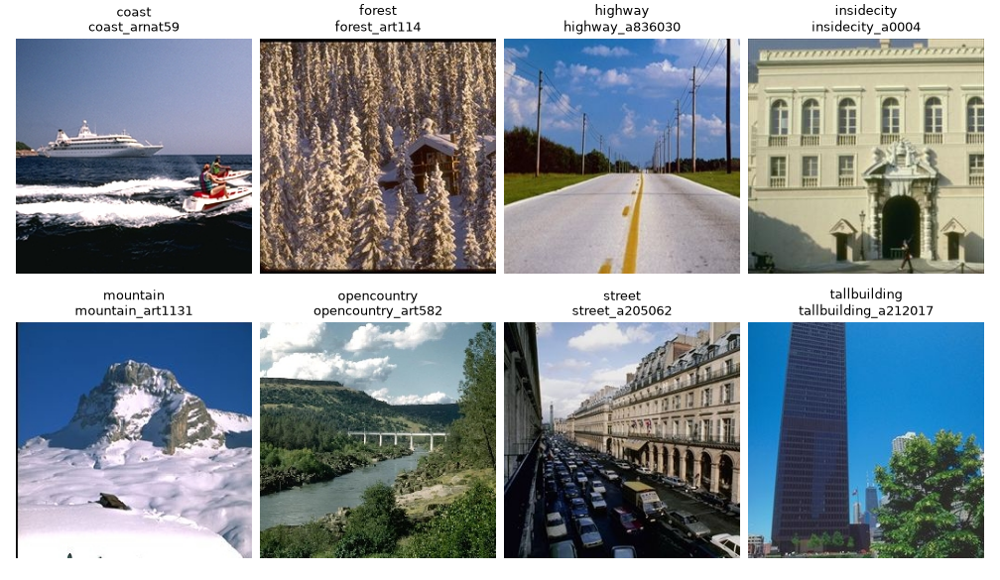

Scene8
======

The original Spatial Envelope collection contains 2,688 RGB outdoor scene images
in eight classes, each 256 x 256 pixels. The builder preserves original JPEG
bytes, labels, and image IDs. It exposes the complete collection as ``train``;
this is not an official training partition.

   One example per class, selected by the first image ID in each class.
   Source images are resized for display without cropping or changing labels.

Usage
-----

.. code-block:: python

   from stable_datasets.images import Scene8

   ds = Scene8(split="train")
   sample = ds[0]  # image: PIL image, label: int, image_id: str
   print(ds.features["label"].names)

   # Use the original ZIP without downloading it again.
   ds = Scene8(split="train", archive_path="/data/scene8.zip")

Class IDs follow the fixed order ``coast``, ``forest``, ``highway``, ``insidecity``,
``mountain``, ``opencountry``, ``street``, and ``tallbuilding``. Rows are sorted
by image ID. Standard caching, formatting, and transforms are supported.

Testing and validation
----------------------

Offline tests check class parsing, invalid inputs, original image bytes, and
cache reopening. The complete source audit verified every image. See
:download:`recorded data checks <audits/scene8_isic2016_protocol_review.json>`.

The evaluation example creates approximately 60% fitting, 20% validation, and
20% test partitions. Identical RGB images stay in the same partition:

* ``insidecity_urb992`` / ``tallbuilding_urb992`` have conflicting source labels.
* ``mountain_sclos4`` / ``mountain_sharp59`` share the mountain label.

Both original records and labels remain in the builder. Grouping prevents these
pairs crossing evaluation partitions; it does not rule out near-duplicates.
The main validation uses frozen DINO features and a trained linear classifier.
See the :doc:`integration report <experiments/scene8_isic2016/REPORT>` for the
setup, results, and short reproduction workflow.

Source and terms
----------------

Original page and download:
https://people.csail.mit.edu/torralba/code/spatialenvelope/

The original page does not specify a dataset-wide license. The library's code
license does not grant a license to redistribute the images. Download checksums
identify the locally audited release rather than publisher signatures.

Reference: Aude Oliva and Antonio Torralba, *Modeling the shape of the scene:
A holistic representation of the spatial envelope*, IJCV 42, 145--175, 2001.
