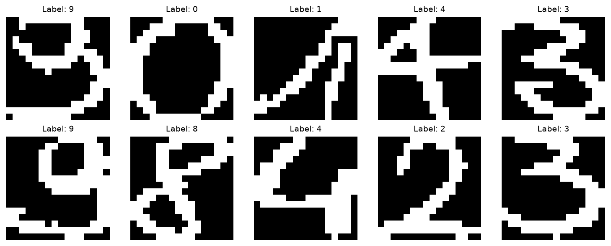

Semeion
=======

.. raw:: html

   

   
   
   
   
   

Overview
--------

Semeion is a handwritten digit recognition dataset containing 1,593
grayscale images of digits from 0 through 9. It is hosted by the UCI
Machine Learning Repository and was contributed by the Semeion Research
Center of Sciences of Communication.

Each image has a resolution of 16x16 pixels, resulting in 256 pixel
features per example. The original dataset stores images as flattened
vectors of binary pixel values, where each pixel is represented by
either 0 or 1.

Each record also contains 10 binary class indicators corresponding
to the digits 0 through 9. Exactly one class indicator is active
for each example.

The dataset is suitable for supervised image classification,
handwritten digit recognition, and evaluating machine learning
algorithms on small grayscale images.

Dataset Splits
--------------

The original Semeion dataset is distributed as a single data file
without predefined training, validation, or test partitions.

This implementation creates a deterministic 80/20 train/test split
using a NumPy random generator initialized with seed 42.

The resulting splits are:

- **Train**: 1,274 images
- **Test**: 319 images
- **Total**: 1,593 images

The same permutation is generated for both splits, ensuring that
training and test examples are disjoint and that the split remains
reproducible across repeated runs.

No separate validation split is provided.

Image Representation
--------------------

The original dataset contains binary pixel values in flattened
vectors of length 256.

During loading, each vector is reshaped into a 16x16 image.
Pixel values are multiplied by 255 and converted to unsigned
8-bit integers.

Images are returned as PIL grayscale images using mode ``L``.

The resulting pixel values are:

- ``0``: Black
- ``255``: White

Images retain their original 16x16 resolution. The loader does
not apply resizing, normalization, or data augmentation.

The original class indicators are converted into integer labels
using the index of the active class.

Labels range from 0 through 9 and correspond directly to the
represented handwritten digit.

Data Structure
--------------

When accessing an example using ``ds[i]``, you receive a dictionary
containing the following fields:

.. list-table::
   :header-rows: 1
   :widths: 20 25 55

   * - Key
     - Type
     - Description
   * - ``image``
     - ``PIL.Image.Image``
     - A grayscale handwritten digit image with resolution 16x16.
   * - ``label``
     - ``int``
     - Integer digit class index from 0 to 9.

Each example contains exactly one image and one class label.

The dataset is configured with ``supervised_keys=("image", "label")``,
allowing it to be used in supervised classification pipelines.

Usage Example
-------------

**Basic Usage**

The following example loads both dataset splits and inspects
individual samples.

.. code-block:: python

    from stable_datasets.images.semeion import Semeion

    def main():
        train = Semeion(split="train")
        test = Semeion(split="test")

        print("Training examples:", len(train))
        print("Test examples:", len(test))

        sample = train[0]

        print("Sample keys:", sample.keys())
        print("Image size:", sample["image"].size)
        print("Image mode:", sample["image"].mode)
        print("Label:", sample["label"])

        # Expected dataset sizes:
        # Training examples: 1274
        # Test examples: 319

        # Expected image properties:
        # Image size: (16, 16)
        # Image mode: L

        class_names = train.features["label"].names
        print("Digit:", class_names[sample["label"]])

    if __name__ == "__main__":
        main()

**Loading All Splits**

Both available splits can be loaded together.

.. code-block:: python

    from stable_datasets.images.semeion import Semeion

    def main():
        datasets = Semeion(split=None)

        print(datasets.keys())

        train = datasets["train"]
        test = datasets["test"]

        print(len(train))
        print(len(test))

    if __name__ == "__main__":
        main()

**Inspecting Pixel Values**

The following example converts a sample image into a NumPy array
to inspect its dimensions and pixel values.

.. code-block:: python

    import numpy as np

    from stable_datasets.images.semeion import Semeion

    def main():
        train = Semeion(split="train")

        sample = train[0]
        pixels = np.asarray(sample["image"])

        print("Shape:", pixels.shape)
        print("Data type:", pixels.dtype)
        print("Unique values:", np.unique(pixels))

        # Shape: (16, 16)
        # Data type: uint8
        # Unique values: [0 255] for images containing both values

    if __name__ == "__main__":
        main()

Implementation Details
----------------------

The loader downloads the original ``semeion.data`` file from the
UCI Machine Learning Repository.

Each record contains 266 numerical values:

- 256 pixel values representing a flattened 16x16 image.
- 10 binary class indicators representing the digit label.

The implementation validates the expected dataset shape and
checks that pixel values and class indicators are binary.

It also verifies that every example has exactly one active
class indicator.

After validation, the loader generates a deterministic
permutation of example indices and selects the appropriate
indices for the requested split.

Each example is returned with an image and an integer label.

Related Datasets
----------------

- **MNIST**: A widely used handwritten digit recognition dataset
  containing grayscale images of digits from 0 to 9.

- **USPS**: A handwritten digit dataset containing 16x16 grayscale
  digit images.

- **EMNIST**: An extension of MNIST containing handwritten digits
  and letters.

References
----------

- `UCI Semeion dataset page <https://archive.ics.uci.edu/dataset/178/semeion+handwritten+digit>`_
- `Original Semeion data file <https://archive.ics.uci.edu/ml/machine-learning-databases/semeion/semeion.data>`_
- `UCI Machine Learning Repository <https://archive.ics.uci.edu/>`_
- **License**: `Creative Commons Attribution 4.0 International (CC BY 4.0) <https://creativecommons.org/licenses/by/4.0/>`_

Citation
--------

.. code-block:: bibtex

    @misc{semeion_handwritten_digit_178,
      title        = {{Semeion Handwritten Digit}},
      year         = {1998},
      howpublished = {UCI Machine Learning Repository},
      note         = {{DOI}: https://doi.org/10.24432/C5SC8V}
    }