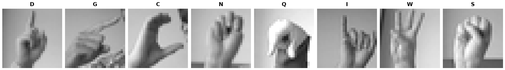

Sign Language MNIST
===================

Overview
--------

Sign Language MNIST is an image classification dataset
containing grayscale images of American Sign Language
(ASL) hand gestures.

The dataset contains 24 classes corresponding to the
letters A-Z, excluding J and Z, whose gestures involve
motion.

Dataset statistics:

- Training samples: 27,455
- Test samples: 7,172
- Number of classes: 24
- Image resolution: 28 x 28
- Image format: grayscale
- Task: image classification

Data Structure
--------------

Each sample is returned as a dictionary with two fields:

.. list-table::
   :header-rows: 1

   * - Key
     - Type
     - Description
   * - ``image``
     - ``PIL.Image.Image``
     - 28 x 28 grayscale image
   * - ``label``
     - int
     - Class index in the range 0-23

Label Mapping
-------------

The original dataset uses letter indices 0-25,
but excludes indices 9 (J) and 25 (Z).

This builder maps the 24 existing classes to
contiguous indices 0-23 while preserving their
alphabetical order.

Usage Example
-------------

.. code-block:: python

   from stable_datasets.images import SignLanguageMNIST

   train_ds = SignLanguageMNIST(split="train")
   test_ds = SignLanguageMNIST(split="test")

   print(len(train_ds))  # 27455
   print(len(test_ds))   # 7172

   sample = train_ds[0]

   image = sample["image"]
   label = sample["label"]

   print(image.size)  # (28, 28)
   print(label)

Validation
----------

The dataset was validated using offline parsing tests,
full train/test split checks, and a supervised CNN
classification experiment.

A small CNN was trained for three epochs using Adam,
a learning rate of 0.001, batch size 64 and seed 42,
without data augmentation.

The model achieved:

- Test accuracy: 89.04%
- Test cross-entropy loss: 0.4134

The experiment ran on Apple Silicon using PyTorch MPS.

To reproduce the benchmark, run from the repository root:

.. code-block:: bash

   python examples/sign_language_mnist_train_eval.py

References
----------

- Original dataset:
  `Sign Language MNIST (Kaggle) <https://www.kaggle.com/datasets/datamunge/sign-language-mnist>`_

- Download mirror:
  `Sign Language GitHub Repository <https://github.com/Elsaraf1/sign-language>`_

The builder downloads the CSV archives from a public
GitHub mirror. Please consult the original dataset page
for attribution and usage conditions.
