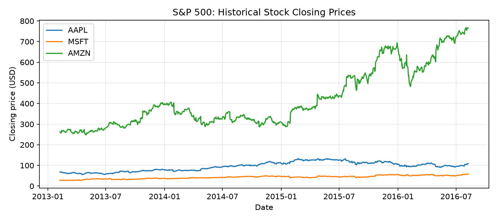

S&P 500 Stock Prices (SP500)
============================

Overview
--------

The SP500 dataset contains historical daily stock prices for companies
included in the S&P 500 dataset published by Cam Nugent on Kaggle.

The observations cover approximately February 2013 to February 2018.
Each example represents one stock on one trading day.

The dataset provides raw OHLCV observations without normalization or
precomputed rolling windows.

- **Train**: 429,550 observations
- **Validation**: 94,343 observations
- **Test**: 95,136 observations

The splits are chronological, using approximately 70%, 15%, and 15%
of the unique trading dates. All stocks on a given date belong to
the same split.

Data Structure
--------------

Each example is a dictionary containing:

.. list-table::
   :header-rows: 1
   :widths: 20 20 60

   * - Key
     - Type
     - Description
   * - ``date``
     - string
     - Trading date in YYYY-MM-DD format
   * - ``ticker``
     - string
     - Stock ticker symbol
   * - ``open``
     - float
     - Opening price
   * - ``high``
     - float
     - Highest price
   * - ``low``
     - float
     - Lowest price
   * - ``close``
     - float
     - Closing price
   * - ``volume``
     - int
     - Daily trading volume

Usage Example
-------------

.. code-block:: python

    from stable_datasets.timeseries import SP500

    ds_train = SP500(split="train")
    ds_val = SP500(split="validation")
    ds_test = SP500(split="test")

    sample = ds_train[0]
    print(sample)

    # Optional NumPy formatting
    ds_numpy = ds_train.with_format("numpy")

Users can construct rolling windows, returns, and normalized features
according to their downstream machine-learning tasks.

Quantitative Evaluation
-----------------------

The dataset contains 619,029 daily stock observations.

.. list-table::
   :header-rows: 1

   * - Split
     - Observations
     - Date range
     - Unique tickers
   * - Train
     - 429,550
     - 2013-02-08 to 2016-08-08
     - 498
   * - Validation
     - 94,343
     - 2016-08-09 to 2017-05-09
     - 501
   * - Test
     - 95,136
     - 2017-05-10 to 2018-02-07
     - 505

All five OHLCV fields have zero missing values in every split.

The chronological split boundaries do not overlap. The number of
unique tickers varies across splits because stock coverage changes
over time.

References
----------

- Source: https://www.kaggle.com/datasets/camnugent/sandp500
- Download: https://www.kaggle.com/api/v1/datasets/download/camnugent/sandp500

Citation
--------

Dataset published by Cam Nugent on Kaggle. Refer to the source page
for attribution and applicable usage terms.
