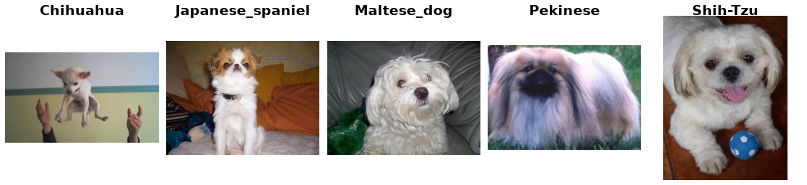

Stanford Dogs
=============

.. raw:: html

   

   
   
   
   

Overview
--------

The Stanford Dogs dataset is designed for fine-grained image categorization. It contains 20,580 images of 120 dog breeds from around the world, built from ImageNet. The official split uses 100 images per class for training and the remaining images for testing.

- **Train**: 12,000 images (100 per class)
- **Test**: 8,580 images

Data Structure
--------------

When accessing an example using ``ds[i]``, you will receive a dictionary with the following keys:

.. list-table::
   :header-rows: 1
   :widths: 20 20 60

   * - Key
     - Type
     - Description
   * - ``image``
     - ``PIL.Image.Image``
     - H×W×3 RGB image (sizes vary)
   * - ``label``
     - int
     - Class label (0-119), in the order of the official WordNet-ID folders (0 = Chihuahua, 119 = African_hunting_dog)

Notes
-----

- **Splits** follow the official ``train_list.mat`` and ``test_list.mat`` files.
- **Color mode**: every image is returned as 3-channel RGB. The source archive contains one RGBA image (``n02105855_2933.jpg``), which is converted to RGB so that images can be batched together.
- **Bounding boxes**: the official per-image bounding-box annotations are not included; this builder provides class labels only.
- **ImageNet overlap**: all images come from ImageNet. Results from models pretrained on ImageNet are therefore not a clean transfer evaluation on this dataset.
- **Download size**: the image archive is about 794 MB.

Usage Example
-------------

**Basic Usage**

.. code-block:: python

    from stable_datasets.images.stanford_dogs import StanfordDogs

    # First run will download + prepare cache, then return the split as a HF Dataset
    ds = StanfordDogs(split="train")

    # If you omit the split (split=None), you get a DatasetDict with all available splits
    ds_all = StanfordDogs(split=None)

    sample = ds[0]
    print(sample.keys())  # {"image", "label"}

    # Map a label back to its breed name
    print(ds.info.features["label"].names[sample["label"]])

    # Optional: make it PyTorch-friendly
    ds_torch = ds.with_format("torch")

Related Datasets
----------------

- **CUB-200**: Fine-grained bird species classification
- **FGVC Aircraft**: Fine-grained aircraft model classification
- **Cars196**: Fine-grained car model classification

References
----------

- Official website: http://vision.stanford.edu/aditya86/ImageNetDogs/
- License: not stated by the dataset authors; the images originate from ImageNet

Citation
--------

.. code-block:: bibtex

    @inproceedings{khosla2011novel,
    author    = {Aditya Khosla and Nityananda Jayadevaprakash and Bangpeng Yao and Li Fei-Fei},
    title     = {Novel Dataset for Fine-Grained Image Categorization},
    booktitle = {First Workshop on Fine-Grained Visual Categorization, IEEE Conference on Computer Vision and Pattern Recognition},
    year      = {2011},
    month     = {June},
    address   = {Colorado Springs, CO}
    }
