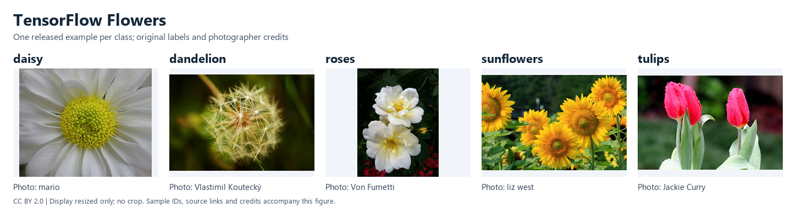

TensorFlow Flowers
==================

   One released image per class, resized without cropping and arranged for
   display. Original labels and photographer credits are retained. See
   :ref:`tf-flowers-teaser-credits` for the image IDs, sources and license.

Source and Scale
----------------

`TensorFlow Flowers <https://www.tensorflow.org/datasets/catalog/tf_flowers>`_
is the five-class photograph collection used by the
`TensorFlow image-loading tutorial
<https://www.tensorflow.org/tutorials/load_data/images>`_. It is separate from
Oxford Flowers-17 and Flowers-102.

The official `flower_photos.tgz archive
<https://storage.googleapis.com/download.tensorflow.org/example_images/flower_photos.tgz>`_
contains 3,670 JPEG photographs and ``flower_photos/LICENSE.txt``. It is
228,813,984 bytes, with SHA-256
``4c54ace7911aaffe13a365c34f650e71dd5bf1be0a58b464e5a7183e3e595d9c``.
These values match the
`published TFDS checksum record
<https://github.com/tensorflow/datasets/blob/2dff5ebbf41953c3f8eeb892c6354f98ee4ef564/tensorflow_datasets/datasets/tf_flowers/checksums.tsv>`_.
The record names the original HTTP URL; the builder uses HTTPS with the same
checksum. No TensorFlow or TFDS installation is required to load the data.

Labels follow the
`TFDS class order
<https://github.com/tensorflow/datasets/blob/2dff5ebbf41953c3f8eeb892c6354f98ee4ef564/tensorflow_datasets/datasets/tf_flowers/tf_flowers_dataset_builder.py>`_,
which is not alphabetical:

.. list-table::
   :header-rows: 1
   :widths: 15 50 35

   * - Label
     - Class
     - Photographs
   * - 0
     - dandelion
     - 898
   * - 1
     - daisy
     - 633
   * - 2
     - tulips
     - 799
   * - 3
     - sunflowers
     - 699
   * - 4
     - roses
     - 641

Schema and Collection
---------------------

``TFFlowers`` uses ``supervised_keys=("image", "label")``. Each sample contains:

- ``image``: an ``Image`` feature, returned as an RGB PIL image at its released
  dimensions by default and stored as lossless PNG.
- ``label``: a ``ClassLabel`` integer in the fixed order above.
- ``image_id``: the full category-relative path ``<class>/<source_filename>.jpg``.
- ``attribution``: the exact per-image line from ``LICENSE.txt``, including
  the photographer credit and its original photograph or profile URL.

``TFFlowers()`` and ``TFFlowers(split=None)`` return a ``StableDatasetDict``
containing only ``train``. ``TFFlowers(split="train")`` returns that
``StableDataset`` with all 3,670 records. The archive has no fixed official
training, validation or test partition; ``train`` names the entire collection.

Original IDs, duplicate records and released labels are retained. The builder
does not crop, resize, normalize, apply EXIF reorientation or encode JPEG a
second time. RGB decoding and PNG storage preserve decoded pixels, rather
than the original JPEG bytes. There is no mask field.

Loading and Cache
-----------------

The first load downloads the public archive and prepares the native cache:

.. code-block:: python

   from stable_datasets.images import TFFlowers

   options = dict(
       download_dir="/your/data/downloads",
       processed_cache_dir="/your/data/processed",
   )
   collections = TFFlowers(**options)
   assert set(collections) == {"train"}
   dataset = TFFlowers(split="train", **options)
   sample = dataset[0]
   print(sample["image_id"], sample["label"], sample["attribution"])

The original archive, including ``flower_photos/LICENSE.txt``, remains in the
download cache. The opening license declaration is also exposed through
``dataset.info.license``. Every cold native build verifies the archive checksum,
including an existing raw-download cache hit. Subsequent loads reuse the
processed cache. ``with_format("raw")`` exposes the encoded PNG bytes.

Members are read without filesystem extraction. Unsafe paths, links, duplicate
canonical members, unknown image categories, missing or conflicting attribution,
and corrupt photographs raise errors.

Duplicates and Labels
---------------------

The release contains these three pairs with identical file bytes and decoded
pixels:

- ``sunflowers/14889392928_9742aed45b_m.jpg`` and
  ``sunflowers/15066430311_fb57fa92b0_m.jpg``.
- ``sunflowers/15069459615_7e0fd61914_n.jpg`` and
  ``sunflowers/15072973261_73e2912ef2_n.jpg``.
- ``roses/15922772266_1167a06620.jpg`` and
  ``tulips/15922772266_1167a06620.jpg``.

The last pair has two different original labels. Its full category-relative
IDs remain distinct even though the basenames match. The builder neither
removes duplicates nor changes these labels. When constructing evaluation
partitions, keep duplicate or verified same-photo records together to avoid
leakage. This does not resolve the roses/tulips label conflict or rule out
other near duplicates and overlap with pretraining data. The builder does not
create experimental partitions or group IDs.

License and Attribution
-----------------------

The archive's ``LICENSE.txt`` declares
`Creative Commons Attribution 2.0 <https://creativecommons.org/licenses/by/2.0/>`_
for the photographs and lists their photographers. Every image has an
attribution entry: 3,661 include an individual Flickr photo URL, and nine
include a photographer name and profile URL. Those nine entries still have
attribution and archive-declared license coverage; no photo-specific URL is
invented for them. Retain the original license and per-image credits when
using the photographs. ``attribution`` preserves the original line, including
spacing, Unicode and the supplied URL.

The image license is distinct from the TFDS source-code and TensorFlow website
licenses. The repository includes only the five reduced-size previews credited
below, not the dataset archive or full-resolution photographs.

.. _tf-flowers-teaser-credits:

Teaser Credits
~~~~~~~~~~~~~~

The teaser uses the lexicographically first full image ID in each class of
the checksum-verified archive. The following credits and URLs come from its
original ``LICENSE.txt``; all five photographs are declared
`CC BY 2.0 <https://creativecommons.org/licenses/by/2.0/>`_. Only
aspect-ratio-preserving resizing, padding and labels were added, without
cropping or model preprocessing.

.. list-table:: Photograph credits, from left to right
   :header-rows: 1
   :widths: 65 35

   * - Released image ID
     - Photographer / original source
   * - ``daisy/100080576_f52e8ee070_n.jpg``
     - `mario <https://www.flickr.com/photos/64738468@N00/100080576/>`_
   * - ``dandelion/10043234166_e6dd915111_n.jpg``
     - `Vlastimil Koutecký <https://www.flickr.com/photos/vlastimil_koutecky/10043234166/>`_
   * - ``roses/10090824183_d02c613f10_m.jpg``
     - `Von Fumetti <https://www.flickr.com/photos/104286287@N06/10090824183/>`_
   * - ``sunflowers/1008566138_6927679c8a.jpg``
     - `liz west <https://www.flickr.com/photos/calliope/1008566138/>`_
   * - ``tulips/100930342_92e8746431_n.jpg``
     - `Jackie Curry <https://www.flickr.com/photos/octoberdog/100930342/>`_

Dataset reference: TensorFlow, *TensorFlow Flowers (tf_flowers)*,
`dataset catalog <https://www.tensorflow.org/datasets/catalog/tf_flowers>`_.
Credit the individual photographers through the archive attribution records.
