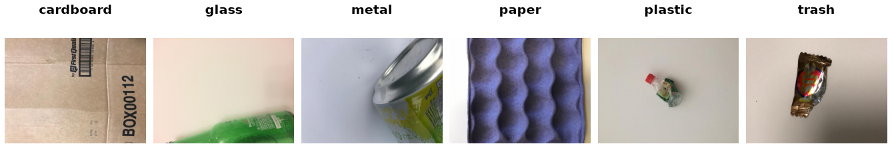

TrashNet
========

Overview
--------

TrashNet contains 2,527 RGB images of household waste in six classes.
Images in the resized archive are 512 x 384 pixels. The download comes from
the authors' Hugging Face dataset, linked from the original repository.
macOS metadata files are excluded.

The builder provides 2,019 ``train`` and 508 ``test`` examples. Within each
class, full archive paths are sorted lexicographically (not numerically),
and zero-based positions 0, 5, 10, ... go to ``test``. All remaining images
go to ``train``. This is a deterministic, class-wise holdout defined by this
builder, not the original authors' experimental split.

   One actual dataset image per class, generated with ``generate_teaser.py``.

.. list-table:: Class counts
   :header-rows: 1

   * - Label
     - Class
     - Total
     - Train
     - Test
   * - 0
     - cardboard
     - 403
     - 322
     - 81
   * - 1
     - glass
     - 501
     - 400
     - 101
   * - 2
     - metal
     - 410
     - 328
     - 82
   * - 3
     - paper
     - 594
     - 475
     - 119
   * - 4
     - plastic
     - 482
     - 385
     - 97
   * - 5
     - trash
     - 137
     - 109
     - 28

Data Structure
--------------

Each example is a dictionary containing:

- ``image``: a decoded RGB ``PIL.Image.Image``.
- ``label``: an integer from 0 to 5, in the class order above.

Usage Example
-------------

.. code-block:: python

    from stable_datasets.images import TrashNet

    dataset = TrashNet(split="train")
    sample = dataset[0]
    class_names = dataset.info.features["label"].names
    print(class_names[sample["label"]])

Reproduce the figure from the repository root:

.. code-block:: bash

    python generate_teaser.py --name TrashNet --num-samples 6 --output docs/source/datasets/teasers/trashnet_teaser.png

References
----------

- Homepage: https://github.com/garythung/trashnet
- License: MIT

Citation
--------

.. code-block:: bibtex

    @misc{thung2016trashnet,
        author = {Thung, Gary and Yang, Mindy},
        title = {{TrashNet}: Dataset of Images of Trash},
        year = {2016},
        howpublished = {GitHub repository},
        url = {https://github.com/garythung/trashnet}
    }
