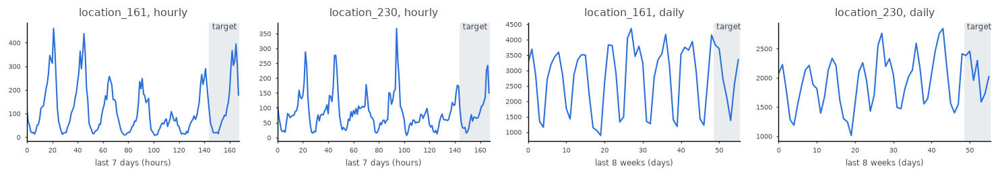

Uber TLC
========

.. raw:: html

   

   
   
   
   

Overview
--------

Uber pickups in New York City per taxi zone, January to June 2015, built from the raw trip records that
FiveThirtyEight obtained from the NYC Taxi & Limousine Commission. Every pickup (14.3 million) is counted in its
taxi zone (``locationID``) and hour or day, with zero for periods without pickups. There are 262 zones, so 262
series. This is the Uber TLC dataset of the Chronos paper (Ansari et al., 2024); the counts match its published
copy exactly.

Two configs:

.. list-table::
   :header-rows: 1
   :widths: 20 20 20 20 20

   * - Config
     - Length
     - Frequency
     - Prediction length
     - MASE seasonality
   * - ``hourly`` (default)
     - 4,344
     - ``h``
     - 24
     - 24
   * - ``daily``
     - 181
     - ``D``
     - 7
     - 1

``UberTLC.SETTINGS[config]`` gives (frequency, prediction length, seasonality). The splits follow the standard
forecasting protocol used by Chronos and GluonTS: ``test`` holds each full series and the forecast target is its last
prediction-length points; ``train`` holds the same series without them.

Data Structure
--------------

.. list-table::
   :header-rows: 1
   :widths: 20 20 60

   * - Key
     - Type
     - Description
   * - ``series``
     - list of float32
     - Pickup counts per hour or day
   * - ``item_id``
     - str
     - Taxi zone, ``location_001`` ... ``location_265``
   * - ``start``
     - str
     - ISO timestamp of the first point (``2015-01-01T00:00:00``)

Usage Example
-------------

.. code-block:: python

    import numpy as np
    from stable_datasets.timeseries import UberTLC

    daily = UberTLC("daily", split="test")
    _, H, season = UberTLC.SETTINGS["daily"]
    y = np.asarray(daily[0]["series"])
    context, target = y[:-H], y[-H:]

References
----------

- Homepage: https://github.com/fivethirtyeight/uber-tlc-foil-response
- Chronos: https://arxiv.org/abs/2403.07815

Citation
--------

.. code-block:: bibtex

    @misc{fivethirtyeight2015uber,
      title={Uber TLC FOIL Response},
      author={FiveThirtyEight},
      howpublished={\url{https://github.com/fivethirtyeight/uber-tlc-foil-response}},
      year={2015}
    }
