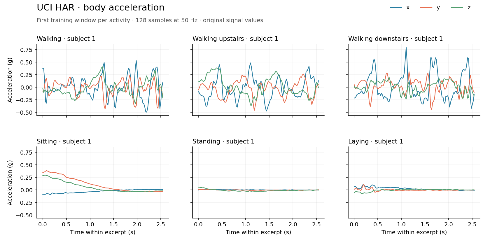

UCI HAR
========

Overview
--------

``UCIHAR`` loads smartphone inertial signals from 30 participants performing
six activities. The source provides filtered, overlapping windows of 128 samples
at 50 Hz (2.56 seconds per window). The builder retains the nine signal channels;
it does not load the separate 561-feature vectors or apply further preprocessing.

The figure shows the first training window for each activity. Each panel covers
one window; the panels are not consecutive segments of a recording.

Splits
------

The official subject-disjoint partitions are preserved:

* ``train``: 7,352 windows from 21 subjects.
* ``test``: 2,947 windows from nine different subjects.

Data Structure
--------------

* ``series``: a nested list of float32 values with shape ``(128, 9)``.
* ``label``: an integer from 0 to 5, obtained by subtracting one from the source label.
* ``subject_id``: the original subject identifier, from 1 to 30.

Channels are body acceleration x/y/z, body angular velocity x/y/z, then total
acceleration x/y/z. Acceleration is measured in g and angular velocity in rad/s.
The order is available as ``UCIHAR.CHANNEL_NAMES``.

Labels 0 through 5 denote walking, walking upstairs, walking downstairs, sitting,
standing and laying, respectively. The source windows overlap by 50%; the builder
preserves their order within each split.

Usage
-----

.. code-block:: python

   import numpy as np
   from stable_datasets.timeseries import UCIHAR

   train = UCIHAR(split="train")
   sample = train[0]
   signals = np.asarray(sample["series"], dtype=np.float32)
   print(signals.shape, sample["label"], sample["subject_id"])

Pass ``download_dir`` and ``processed_cache_dir`` to choose the raw-download and
Arrow-cache locations, or set ``STABLE_DATASETS_CACHE_DIR`` for both.

Source and License
------------------

* Homepage: https://archive.ics.uci.edu/dataset/240/human+activity+recognition+using+smartphones
* License metadata: CC BY 4.0, as listed on the current UCI dataset page.

The README inside the original archive contains an older prohibition on commercial
use. This differs from the current UCI page; the builder records UCI's published
license, while this note preserves the discrepancy.

Citation
--------

.. code-block:: bibtex

   @misc{uci_har_2013,
     author = {Reyes-Ortiz, Jorge and Anguita, Davide and Ghio, Alessandro and Oneto, Luca and Parra, Xavier},
     title = {Human Activity Recognition Using Smartphones},
     year = {2013},
     publisher = {UCI Machine Learning Repository},
     doi = {10.24432/C54S4K},
     url = {https://doi.org/10.24432/C54S4K}
   }

The original study is Anguita et al., *A Public Domain Dataset for Human Activity
Recognition Using Smartphones*, ESANN 2013.
