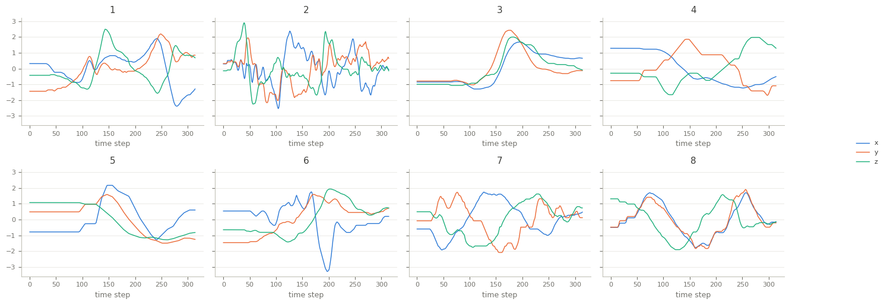

UWaveGestureLibrary
===================

.. raw:: html

   

   
   
   
   
   

Overview
--------

Multivariate time series classification dataset from the UEA archive (Bagnall et al., 2018), built from
the uWave gesture library (Liu et al., 2009). Each recording is one of eight simple gestures, given as the
x, y and z acceleration of the motion (3 channels) over 315 steps.

The loader passes the archive's data through unchanged.

- **Train**: 120 recordings (15 per class).
- **Test**: 320 recordings (40 per class).

The archive labels the gestures ``1.0`` to ``8.0``; the class names are the gesture numbers ``1`` to ``8``
of the uWave paper, in that order.

Data Structure
--------------

.. list-table::
   :header-rows: 1
   :widths: 20 20 60

   * - Key
     - Type
     - Description
   * - ``series``
     - list of list of float32
     - Accelerometer recording, shape ``(315, 3)``: time steps by channels
   * - ``label``
     - int
     - Gesture class (0-7)

Usage Example
-------------

.. code-block:: python

    import numpy as np
    from stable_datasets.timeseries import UWaveGestureLibrary

    train = UWaveGestureLibrary(split="train")
    sample = train[0]
    x = np.asarray(sample["series"])  # (315, 3)
    print(x.shape, train.features["label"].names[sample["label"]])

References
----------

- Homepage: https://timeseriesclassification.com/description.php?Dataset=UWaveGestureLibrary
- Archive record: https://doi.org/10.5281/zenodo.11206282
- Original paper: https://doi.org/10.1109/PERCOM.2009.4912759
- License: CC BY 4.0

Citation
--------

.. code-block:: bibtex

    @inproceedings{liu2009uwave,
      title={uWave: Accelerometer-based Personalized Gesture Recognition and its Applications},
      author={Liu, Jiayang and Wang, Zhen and Zhong, Lin and Wickramasuriya, Jehan and Vasudevan, Venu},
      booktitle={2009 IEEE International Conference on Pervasive Computing and Communications},
      pages={1--9},
      year={2009}
    }

    @article{bagnall2018uea,
      title={The UEA multivariate time series classification archive, 2018},
      author={Bagnall, Anthony and Dau, Hoang Anh and Lines, Jason and Flynn, Michael and Large, James and Bostrom, Aaron and Southam, Paul and Keogh, Eamonn},
      journal={arXiv preprint arXiv:1811.00075},
      year={2018}
    }
